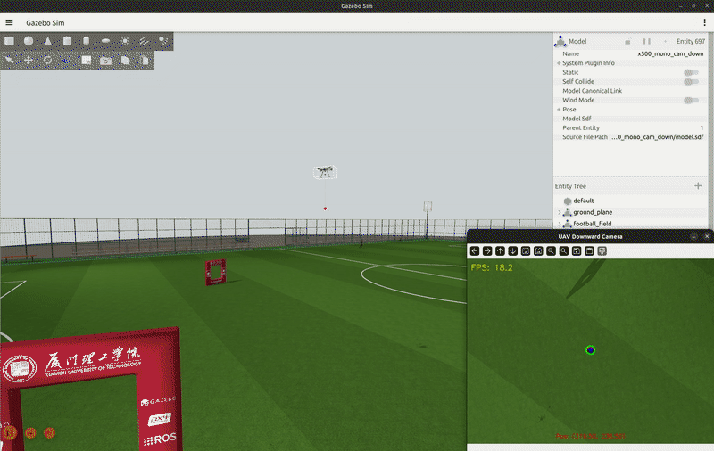

# UAV_slung

A Gazebo simulation environment for UAV slung-payload operations, with vision-based swing-angle estimation and anti-swing control.



## Key Features

<!-- Codex-generated scene-description update requested with removal of the basketball court. -->
* **Football Court Environment:** A 105 × 68 m field, an origin helipad and an entrance 15 m ahead provide visual references for flight and trajectory tracking.
* **Tether & Payload Dynamics:** A 1-meter tether is represented by 20 articulated segments and connected to a spherical payload.
* **Swing-Angle Estimation:** Vision measurements and five observers: ESO, ESO_delay, PESO, EKF2 and EKF3.
* **Anti-Swing Control:** ADRC and PD control with figure-eight, square and setpoint references.

## System Requirements

| Component | Requirement |
| :--- | :--- |
| Ubuntu | 22.04 |
| ROS 2 | Humble |
| PX4 Autopilot | 1.16.2 |
| px4_msgs | release/1.16 |
| Micro-XRCE-DDS-Agent | 3.0.1 |
| Gazebo | Harmonic |
| ros_gz_bridge | gzharmonic |

## Quick Start Guide

### Build

For a new PX4 checkout, apply the magnetometer interface patch once and rebuild PX4:
```bash
git -C ~/PX4-Autopilot apply ~/UAV_slung/sim/px4_magnetometer.patch
cd ~/PX4-Autopilot
make px4_sitl_default -j2
```

Build the ROS package:
```bash
cd ~/UAV_slung/ros2_ws
source /opt/ros/humble/setup.bash
source ~/ws_ros2/install/setup.bash
CMAKE_BUILD_PARALLEL_LEVEL=2 colcon build --symlink-install
source install/setup.bash
```

`~/ws_ros2` is the dependency workspace containing px4_msgs.
Adjust it to your installation. Load the following environment in each new terminal:

```bash
source /opt/ros/humble/setup.bash
source ~/ws_ros2/install/setup.bash
source ~/UAV_slung/ros2_ws/install/setup.bash
```

### Run

Open QGroundControl, then run each command in a separate terminal:

```bash
# 1. Simulation, PX4, DDS agent and camera detection
ros2 launch slung_ctrl sim.launch.py

# 2. Vision, ground truth and swing-angle estimation
ros2 launch slung_ctrl estimation.launch.py

# 3. Interactive control and trajectories; enter takeoff to climb to 8 m
ros2 launch slung_ctrl offboard.launch.py

# In the interactive terminal: takeoff -> eight (continuous) -> home -> land

# Optional: PlotJuggler, when installed
ros2 run plotjuggler plotjuggler
```

For observation-only comparisons, keep simulation and estimation as two separate steps. The default estimation launch starts all five observers together:

```bash
ros2 launch slung_ctrl estimation.launch.py
```

## Options

| Selection | Command option |
|:---:|---|
| Observer | Estimation: `estimator:=eso`, `eso_delay`, `peso`, `ekf2` or `ekf3` |
| ADRC (default: PESO + ADRC) | Offboard terminal: `controller adrc`; `estimator eso`, `eso_delay`, `peso` or `ekf3` |
| PD for EKF2 | Offboard terminal: `controller pd`, then `estimator ekf2` |
| Other trajectories | Offboard terminal: `square` or `setpoint N E U` (metres, positive Up) |
| Scene characters | Enabled by default; disable with `people:=false` |
| Headless simulation | Simulation: `headless:=true` |

