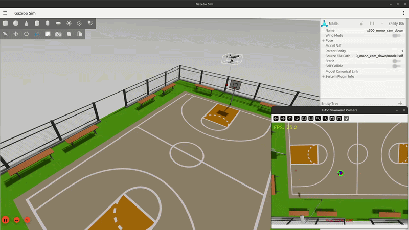

# UAV_slung

A Gazebo simulation environment for UAV slung-payload operations, with vision-based swing-angle estimation and anti-swing control.



## Key Features

<!-- Codex-generated scene-description update requested with removal of the basketball court. -->
* **Football Court Environment:** A 105 × 68 m field, an origin helipad and an entrance 15 m ahead provide visual references for flight and trajectory tracking.
* **Tether & Payload Dynamics:** A 1-meter tether is represented by 20 articulated segments and connected to a spherical payload.
* **Swing-Angle Estimation:** Vision measurements, traditional ESO, delay-compensated ESO with historical visual ZOH, two-state EKF and three-state EKF.
* **Anti-Swing Control:** ADRC and PD control with figure-eight, square and setpoint references.

## System Requirements

| Component | Requirement |
| :--- | :--- |
| Ubuntu | 22.04 |
| ROS 2 | Humble |
| PX4 Autopilot | 1.16.2 |
| px4_msgs | release/1.16 |
| Micro-XRCE-DDS-Agent | 3.0.1 |
| Gazebo | Harmonic |
| ros_gz_bridge | gzharmonic |

## Quick Start Guide

### Build

For a new PX4 checkout, apply the magnetometer interface patch once and rebuild PX4:
```bash
git -C ~/PX4-Autopilot apply ~/UAV_slung/sim/px4_magnetometer.patch
cd ~/PX4-Autopilot
make px4_sitl_default -j2
```

Build the ROS package:
```bash
cd ~/UAV_slung/ros2_ws
source /opt/ros/humble/setup.bash
source ~/ws_ros2/install/setup.bash
CMAKE_BUILD_PARALLEL_LEVEL=2 colcon build --symlink-install
source install/setup.bash
```

`~/ws_ros2` is the dependency workspace containing px4_msgs.
Adjust it to your installation. Load the following environment in each new terminal:

```bash
source /opt/ros/humble/setup.bash
source ~/ws_ros2/install/setup.bash
source ~/UAV_slung/ros2_ws/install/setup.bash
```

### Run

Open QGroundControl, then run each command in a separate terminal:

```bash
# 1. Simulation, PX4, DDS agent and camera detection
ros2 launch slung_ctrl sim.launch.py

# 2. Vision, ground truth and swing-angle estimation
ros2 launch slung_ctrl estimation.launch.py estimator:=all

# 3. Interactive control and trajectories; enter takeoff to climb to 8 m
ros2 launch slung_ctrl offboard.launch.py

# In the interactive terminal: takeoff -> eight (continuous) -> home -> land

# Optional: PlotJuggler, when installed
ros2 run plotjuggler plotjuggler
```

For observation-only comparisons, keep simulation and estimation as two separate steps. Start the simulator as above, then start all five observers together in another terminal:

```bash
ros2 launch slung_ctrl estimation.launch.py estimator:=all
```

## Options

| Selection | Command option |
|:---:|---|
| Observer | Estimation: `estimator:=eso`, `eso_delay`, `peso`, `ekf2` or `ekf3` |
| ADRC (default: PESO + ADRC) | Offboard terminal: `controller adrc`; `estimator eso`, `eso_delay`, `peso` or `ekf3` |
| PD for EKF2 | Offboard terminal: `controller pd`, then `estimator ekf2` |
| Other trajectories | Offboard terminal: `square` or `setpoint N E U` (metres, positive Up) |
| Headless simulation | Simulation: `headless:=true` |

<!-- Codex-generated section: Main Interfaces; added with the owner's permission. -->
## Main Interfaces

`<method>` is `eso`, `eso_delay`, `peso`, `ekf2` or `ekf3`. Swing `vector.x/y` represents **East / North**; all angle messages use **rad**, rates use **rad/s**, and disturbances use **rad/s²**. Terminal and exported figures convert angles/rates to degrees for display.

| Topic | Message type | Purpose |
|---|---|---|
| `/uav/vision/payload_pixel` | `geometry_msgs/PointStamped` | Detected floating-point center, in pixels |
| `/uav/swing/truth/angle` | `geometry_msgs/Vector3Stamped` | Ground-truth swing angles for evaluation |
| `/uav/swing/vision/angle` | `geometry_msgs/Vector3Stamped` | Visual swing-angle measurements |
| `/uav/swing/<method>/angle` | `geometry_msgs/Vector3Stamped` | Estimated swing angles |
| `/uav/swing/<method>/rate` | `geometry_msgs/Vector3Stamped` | Estimated angular rates |
| `/uav/swing/<method>/disturbance` | `geometry_msgs/Vector3Stamped` | Lumped disturbance; ESO, ESO_delay, PESO and EKF3 only |
| `/uav/swing/<method>/state` | `slung_ctrl/SwingADRCState` | Angle, rate and disturbance from one update, sharing one timestamp; ESO, ESO_delay, PESO and EKF3 only |
| `/uav/reference/angle` / `/uav/reference/rate` | `geometry_msgs/Vector3Stamped` | Angular-task references in rad / rad/s |
| `/uav/reference/position` | `geometry_msgs/Point` | Position reference in PX4 NED coordinates, in meters |
| `/uav/reference/yaw` | `std_msgs/Float32` | Yaw reference in radians, using PX4's NED convention |
| `/uav/offboard/command` | `std_msgs/String` | Command input, using the same syntax as the interactive terminal |
| `/uav/offboard/status` | `std_msgs/String` | JSON status: flight phase, task, selected observer/controller and readiness |
| `/fmu/out/vehicle_attitude` | `px4_msgs/VehicleAttitude` | PX4 estimated attitude for capture-time visual conversion |
| `/fmu/out/vehicle_local_position` | `px4_msgs/VehicleLocalPosition` | Estimated acceleration: `ax` = North, `ay` = East, in m/s² |
| `/fmu/out/vehicle_odometry` | `px4_msgs/VehicleOdometry` | Position and velocity feedback for the controller |
| `/fmu/in/trajectory_setpoint` | `px4_msgs/TrajectorySetpoint` | Controller setpoints sent to PX4 |
| `/fmu/in/offboard_control_mode` | `px4_msgs/OffboardControlMode` | Offboard control-mode selection and heartbeat |
| `/fmu/in/vehicle_command` | `px4_msgs/VehicleCommand` | Vehicle commands, including arming and mode switching |

The SI interface uses `theta_east_rad`, `theta_north_rad`, `rate_east_rad_s` and `rate_north_rad_s` in `SwingADRCState`. Rebuild and restart all nodes together; archived degree-based recordings need explicit conversion. Human-facing parameters such as `vision_std_deg` retain their existing values and named units.

For PlotJuggler, raw ROS channels are radians. Right-click a plot → **Apply filter to data...** → **Scale/Offset**; set Scale to `57.29577951308232` and Offset to `0` for each angle/rate curve. Alternatively, use the Lua transform `return value * 180 / math.pi`. This changes only the display to degrees/deg/s, retaining timestamps. Save the layout to reuse the setting; the console already displays degrees.
