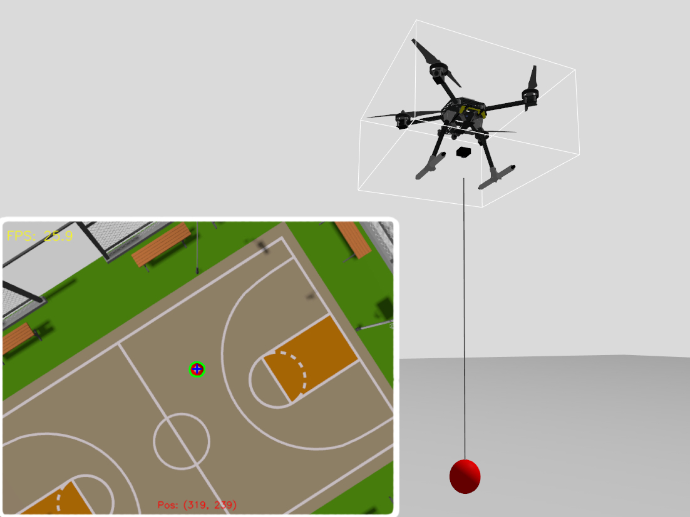

# Swing Angle Estimation and Control for Multi-Rotor Slung-Load with Onboard Vision Delay Compensation
# 搭载机载视觉时延补偿的多旋翼吊挂载荷摆角估计与控制

## Abstract （摘要）
&emsp;&emsp;多旋翼吊挂系统因强耦合与欠驱动特性，其载荷摇摆抑制是保障飞行安全的核心难题。机载下视视觉为摆角测量提供了轻量化的非接触式方案，但由于相机刚性固连安装引发的“视场姿态耦合”以及图像处理带来的“反馈滞后”，极易导致闭环系统振荡失稳。针对上述痛点，本文提出了一种搭载时延补偿的视觉摆角估计与闭环控制方法。首先，设计了基于引力对齐的姿态解耦策略，将机体系观测向量实时映射至惯性空间，从根本上剔除了机体姿态波动引入的伪摆角干扰；其次，构建了基于非线性动力学模型的多速率前向预测器，利用高频（200Hz）机载运动学状态推演低频（25Hz）视觉数据，精确补偿了处理耗时，有效克服了系统的相位滞后与零阶保持效应。基于 ROS 2(Robot Operating System 2) 与 Gazebo 的高保真物理仿真（引入多段铰接柔性绳索模型）表明：在大动态机动下，所提方法的摆角估计均方根误差（RMSE）较未补偿视觉显著降低了 66.71%。在复杂三维“8”字形轨迹跟踪中，该方法为系统提供了无相移、低噪声的高保真反馈，成功将最大动态摆角约束在 $\pm 3.51^\circ$ 的安全区间内，大幅提升了多旋翼吊挂飞行的动态稳定性与作业安全性。
**Keywords:** Multi-Rotor UAV, Slung-Load, Swing Angle Estimation, Onboard Vision, Delay Compensation, Forward Prediction
**关键词：** 多旋翼无人机，吊挂载荷，摆角估计，机载视觉，时延补偿，前向预测

## I. Introduction （引言）
### A. Background （研究背景）
&emsp;&emsp;随着低空经济与无人飞行器技术的快速发展，旋翼无人机凭借其垂直起降能力和高机动性，在应急救援、物流配送以及海洋物资拖拽作业等领域展现出巨大的应用潜力。在物资的空中运输中，相较于固定挂载或机械臂夹持，吊绳悬挂方式因其机械成本低且对负载体积无严格限制，具有极高的任务适应性。然而，旋翼无人机自身存在典型的欠驱动特性，当引入悬挂负载后，系统自由度增加且存在强烈的状态耦合。在复杂的飞行机动或外部风扰下，负载极易产生剧烈摇摆，这种摇摆不仅会降低运输效率，其产生的反作用力矩更会严重威胁无人机的飞行稳定与安全。因此，实现高效的“摆角抑制”是多旋翼吊挂系统迈向实用化的核心瓶颈。为了抑制摆角，开环控制方案（如输入整形与轨迹规划）被广泛提出，但此类方法对系统参数偏差和外部环境干扰极为敏感。相比之下，基于摆角状态反馈的闭环控制方案能够显著提升系统的抗干扰能力与鲁棒性。这就要求系统必须具备对负载摇摆状态进行高保真、低延迟实时感知的能力。

### B. Related Work （相关工作）
&emsp;&emsp;针对多旋翼吊挂负载的状态感知与抑摆控制，早期研究主要致力于建立系统的耦合动力学模型并设计相应的控制律。例如，Palunko 等 [1] 探讨了多旋翼吊挂系统在敏捷飞行下的安全运输与负载操控策略，奠定了该领域系统控制的基础。为了实现闭环抑摆，获取准确的负载摆角状态至关重要。Lee 与 Kim [2] 提出了针对多旋翼吊挂飞行的自主摆角估计算法，为闭环稳定控制提供了初步的状态反馈支持。
&emsp;&emsp;随着机载算力的提升，基于相机的轻量化、非接触式感知逐渐成为解决吊挂状态估计的核心方案。Gassner 等 [3] 探索了基于视觉的两架四旋翼无人机协同运输悬挂负载的动态协作；Tang 等 [4] 进一步利用视觉控制实现了搭载悬挂负载无人机的高激进（Aggressive）飞行，充分展示了视觉反馈在提升系统动态性能与作业灵活性上的巨大潜力。
&emsp;&emsp;然而，在实际的高动态闭环飞行中，现有的机载视觉方案仍面临两大严峻挑战。首先是“视场姿态耦合”问题。相机与机体的刚性固连会导致机体自身的横滚与俯仰机动直接耦合到图像特征的运动中，从而引入“伪摆角”干扰。为此，Wang 等 [5] 提出了基于视觉-惯性（Vision-inertial）联合估计的自适应轨迹跟踪策略以提升状态观测的鲁棒性；Panetsos 等 [6] 则尝试引入具备超高时间分辨率的事件相机（Event Camera）来克服传统相机在动态追踪中的局限。
&emsp;&emsp;其次是更为致命的“观测时延”问题。视觉算法固有的图像采集、传输与特征提取耗时，会给闭环系统引入无法忽视的纯滞后（如 25Hz 帧率带来的数十毫秒延迟）。这种滞后会提供错误相位的阻尼反馈信号，极易诱发无人机电机的微分项高频颤震甚至导致系统失稳。针对飞行器位姿估计中的时延问题，Lee 与 Johnson [7] 提出了面向敏捷飞行的视觉-惯性里程计时延补偿算法。
&emsp;&emsp;尽管上述工作在各自领域取得了显著进展，但在多旋翼吊挂这一特定的强耦合、欠驱动场景下，如何轻量化、低成本地同时解决“机体位姿耦合”与“视觉处理时延”仍是一个亟待完善的工程痛点。因此，设计一种能彻底解耦观测扰动并精准补偿相位滞后的前向预测机制，是进一步提升多旋翼吊挂系统飞行包线与安全性的关键。

### C. Main Contributions （本文贡献）
&emsp;&emsp;针对上述机载视觉反馈在姿态耦合与数据滞后方面的痛点，本文提出了一种集视觉姿态解耦与动力学前向预测于一体的实时摆角估计方案，旨在为高动态飞行提供无相移、低噪声的高保真状态反馈。
&emsp;&emsp;本文的主要贡献如下：
1. 提出了一种基于引力对齐的固连视觉姿态解耦方法。 通过将机体系下的视觉观测向量实时映射至世界坐标系，有效剔除了高机动飞行中无人机姿态剧烈变化对观测产生的“伪摆角”干扰，简化了解算逻辑。
2. 设计了基于动力学模型的多速率前向预测时延补偿策略。 针对视觉系统帧率低（25Hz）且存在处理耗时的问题，利用高频（200Hz）的机载运动学状态与系统非线性动力学模型进行状态外推与误差修正，显著抑制了视觉反馈的相位滞后与零阶保持效应。
3. 在具有多段柔性绳索模型的高保真联合仿真中验证了闭环性能。 在 ROS2 与 Gazebo 的 SITL 物理仿真环境中，本文所提方法在 $\pm 40^\circ$ 大摆角工况及“8”字形连续动态机动下，均展现出了优异的估计精度与抑摆控制效果。

## II. System Modeling （系统建模）
&emsp;&emsp;为了实现高精度的摆角估计，首先需要建立多旋翼-吊挂系统的物理模型，并解决由于相机刚性安装在机体上导致的“视场姿态耦合”问题。本章将建立数学模型来描述无人机运动与载荷摆动之间的动力学耦合关系，并通过坐标变换剔除无人机自身姿态变化对视觉观测产生的“伪摆角”干扰。
### A. Geometric Definitions and System Assumptions （几何定义与系统假设）
&emsp;&emsp;为了实现建模、控制与仿真的统一描述，并在模型准确性与工程实用性之间取得平衡，本文首先明确吊挂系统的标准摆角几何定义及相关物理假设。
结合实际吊运作业的观测与控制习惯，将空间吊绳姿态与无人机运动的对应关系解耦为两个平面：
&emsp;&emsp;纵向摆角 $\theta_x$：吊绳在机体 $X-Z$ 平面内与竖直 $Z$ 轴形成的夹角，反映载荷在无人机前进/后退方向的摆动。
&emsp;&emsp;侧向摆角 $\theta_y$：吊绳在机体 $Y-Z$ 平面内与竖直 $Z$ 轴形成的夹角，反映载荷在无人机左/右方向的摆动。
&emsp;&emsp;结合真实物资吊运工况，本文的动力学推导基于以下合理假设：
&emsp;&emsp;假设 1：吊绳视为理想刚性约束，无质量、无弹性伸长，且长度 $L$ 始终保持恒定。
&emsp;&emsp;假设 2：载荷视为集中质点，忽略其自身体积与转动惯量产生的气动效应，仅考虑平动摆动。
&emsp;&emsp;假设 3：吊绳在整个作业及机动过程中始终保持张紧状态，不出现松弛、缠绕或冲击现象。
&emsp;&emsp;假设 4：无人机在控制重心上集中于水平面 $X-Y$ 的运动，高度方向保持稳定（即垂向加速度 ${a}_z = 0$）。
&emsp;&emsp;假设 5：载荷摆角幅值被严格约束在 $(-\pi/2, \pi/2)$ 范围内，保证系统动力学模型无奇异性。
&emsp;&emsp;上述假设既保留了系统强耦合、欠驱动的核心特征，又避免了过度复杂的高阶动态，为后续稳定控制器设计提供了坚实基础。多旋翼吊挂系统的空间坐标系定义与受力分析如图 1 所示。

<figure align="center">
  
  <figcaption>
图1 多旋翼吊挂系统示意图
</figcaption>
</figure>

### B. System Dynamics Model （系统动力学模型）
&emsp;&emsp;实际飞行场景中，受载荷自重与无人机机动约束，绳索通常可维持张紧状态，该刚性假设具备充分的工程合理性。
&emsp;&emsp;以 $X-Z$ 平面为例，设吊挂绳长为 $L$，载荷质量为 $m$，则载荷绕悬挂点的转动惯量为 $I = mL^2$。在飞行过程中，载荷的运动受重力产生的恢复力矩 $\tau_g$、无人机水平加速度 $a_x$ 产生的惯性力矩 $\tau_a$，以及由空气和摩擦引起的等效阻尼力矩 $\tau_c$ 共同作用：
$$\begin{cases}
\tau_g = -mgL\sin\theta_x \\
\tau_a = -ma_xL\cos\theta_x \\
\tau_c = -c\dot{\theta}_x
\end{cases}$$
&emsp;&emsp;其中，$g$ 为重力加速度，$\theta_x$ 为载荷在 $X-Z$ 平面内的摆动角，阻尼系数 $c$ 包含了空气动力学阻尼、模拟软绳的内部阻尼以及绳索在悬挂点处的摩擦损耗。
根据牛顿-欧拉法与刚体定轴转动定律 $I\ddot{\theta}_x = \sum \tau$，可推导出载荷受迫单摆的非线性微分方程：
$$\ddot{\theta}_x = -\frac{g}{L}\sin\theta_x - \frac{1}{L}a_x\cos\theta_x - \frac{c}{mL^2}\dot{\theta}_x$$
&emsp;&emsp;考虑到实际软绳的内部摩擦与空气阻尼难以精确测量，本文在工程实现中将 $\frac{c}{mL^2}$ 作为一个综合等效阻尼系数进行参数化处理，微小的参数失配将由后续的视觉闭环反馈机制进行补偿。
&emsp;&emsp;由于系统的物理对称性，在 $Y-Z$ 平面内，无人机在 $Y$ 轴的加速度 $a_y$ 与载荷摆角 $\theta_y$ 的动力学方程同理。该双轴解耦模型准确建立了无人机机动输入（$a_x$, $a_y$）与载荷摆角响应（$\theta_x$, $\theta_y$）之间的确定性关系。模型中阻尼耗散项的引入，使其能够更真实地反映物理系统的动态衰减过程，这不仅为载荷姿态的观测奠定了基础，更是后续设计前向运动学预测器、有效补偿机载视觉系统固有延时的理论核心。

### C. Onboard Vision Model （机载视觉模型）
&emsp;&emsp;机载单目相机刚性连接于无人机腹部垂直向下观测。根据针孔相机模型，载荷在图像像素坐标系中的位置 $(u, v)$ 与其在归一化相机坐标系下的坐标 $(x_c, y_c)$ 满足以下映射关系：
$$x_c = \frac{u - c_x}{f_x}, \quad y_c = \frac{v - c_y}{f_y}$$
&emsp;&emsp;其中，$(c_x, c_y)$ 为相机的光学主点坐标，$(f_x, f_y)$ 为相机的等效焦距。
由于相机光轴垂直向下，且图像平面坐标轴与机体轴存在 $90^\circ$ 的空间旋转对应关系，因此本文采用 FLU(Forward-Left-Up) 的坐标系定义，所以载荷在机体坐标系下的向量 $V_{body}$ 可表示为：
$$V_{body} = \begin{bmatrix} -y_c \\ -x_c \\ -1.0 \end{bmatrix}$$
&emsp;&emsp;该向量表示了从无人机质心指向载荷质心的空间射线，是后续进行机体到世界坐标系姿态解算的基础。

### D. Gravity Alignment and Attitude Decoupling （引力对齐与姿态解耦）
&emsp;&emsp;由于机载单目相机与无人机机体呈固连安装，其成像平面时刻随无人机的俯仰、横滚动作发生旋转。在惯性空间下即使载荷保持垂直静止，机体姿态的波动也会导致载荷在图像中的像素坐标产生剧烈偏移。这种“姿态耦合”产生的“伪摆角”信号会严重干扰估计器的收敛。
&emsp;&emsp;本文选择将机体坐标系下的视觉观测向量 $V_{body}$ 映射至世界坐标系（World Frame）进行解耦，其核心优势体现在两个维度：
1. 动力学框架的一致性：系统的受迫单摆动力学方程是在以重力方向为基准的惯性空间中建立的。将视觉数据进行“引力对齐”变换，可使观测模型与预测模型的坐标基准直接统一，避免了在非惯性系下引入复杂的牵连加速度补偿。
2. 运算开销的最小化：在机体坐标系下解算摆角时，参考基准（重力向量）随时间动态变化，需实时解算重力向量在机体轴上的分量。而转换至世界坐标系后，重力基准始终保持为常向量 $[0, 0, -1]^T$。在解算三维投影角时，仅需对变换后的 $V_{world}$ 进行简单的分量投影运算，显著降低了高频控制循环中的三角函数运算开销。

&emsp;&emsp;具体算法实现如下：引入机载飞控系统实时解算的归一化姿态四元数 $q = [q_w, q_x, q_y, q_z]^T$。根据四元数到旋转矩阵的映射关系，构建从机体系到世界系的瞬时旋转矩阵 $R_b^w$：
$$R_b^w =
\begin{bmatrix}
1 - 2q_y^2 - 2q_z^2 & 2q_xq_y - 2q_zq_w & 2q_xq_z + 2q_yq_w \\
2q_xq_y + 2q_zq_w & 1 - 2q_x^2 - 2q_z^2 & 2q_yq_z - 2q_xq_w \\
2q_xq_z - 2q_yq_w & 2q_yq_z + 2q_xq_w & 1 - 2q_x^2 - 2q_y^2
\end{bmatrix}$$
&emsp;&emsp;利用 $R_b^w$ 对机体坐标系下的观测方向向量 $V_{body}$ 进行线性变换，得到引力对齐后的世界系方向向量 $V_{world}$：
$$V_{world} = R_b^w V_{body} = \begin{bmatrix} x_w \\ y_w \\ z_w \end{bmatrix}$$
&emsp;&emsp;此时，$V_{world}$ 已经剥离了机体姿态变化的干扰，真实反映了载荷在惯性空间下的几何位置。该解耦策略不仅符合人类对吊挂运动的直观感知，也为后续基于物理模型的延时补偿估计奠定了数据基础。

## III. Swing Angle Calculation with Delay Compensation （带有时延补偿的摆角解算）
&emsp;&emsp;机载视觉系统在提供非接触式观测的同时，由于图像采集、数据传输及特征提取算法的计算开销，不可避免地存在观测时延，而时延会导致反馈信号产生相位滞后，严重时将引发闭环系统发散。本章旨在通过图像处理获取原始摆角观测值，并利用动力学模型进行前向预测，补偿视觉系统引入的系统时延。
### A. Visual-Based Swing Angle Calculation （基于视觉的摆角解算）
&emsp;&emsp;本文利用 OpenCV 库对下视相机捕获的图像进行实时处理。通过 HSV 色彩空间阈值分割提取载荷末端标志物的特征轮廓，并计算其在图像平面的像素质心。随后，利用形态学开闭运算滤除背景噪声，并计算标志物连通域的质心坐标 $(u, v)$。
结合第 II.C 节推导出的世界坐标系观测向量 $V_{world} = [x_w, y_w, z_w]^T$，利用几何投影关系计算载荷在 $X-Z$ 和 $Y-Z$ 平面内的实时观测摆角：
$$\theta_{xw\_vis} = \arctan\left(\frac{x_w}{-z_w}\right), \quad \theta_{yw\_vis} = \arctan\left(\frac{y_w}{-z_w}\right)$$
&emsp;&emsp;其中，此摆角值 $\theta_{vis}$ 包含了从快门曝光时刻到算法输出时刻的累积时延，记为 $\Delta t$。

### B. Dynamics-Based Forward Swing Angle Prediction （基于动力学的前向摆角预测）
&emsp;&emsp;由于机载计算平台性能限制及图像传输链路开销，从曝光时刻到算法输出结果存在显著的处理耗时 $\Delta t$。若直接将该“过时”的观测值作为控制输入，将引发严重的相位滞后。为消除时延影响，本文利用第 II-A 节建立的非线性动力学模型进行状态外推。设图像触发时刻为 $t-\Delta t$，视觉算法在当前时刻 $t$ 输出的观测值为 $\theta_{vis}(t-\Delta t)$。系统通过记录历史时序内的无人机水平加速度 $a$，利用数值积分方法将摆角状态向未来推进 $\Delta t$ 时间步长：
$$\theta_{pred}(t) = \theta_{vis}(t-\Delta t) + \int_{t-\Delta t}^{t} \dot{\theta} \, d\tau$$
&emsp;&emsp;其中，$\dot{\theta}$ 由动力学微分方程实时解算得到。该过程实现了摆角信号从“过去”到“现在”的对齐，通过物理模型补偿了视觉处理链路产生的滞后。

### C. Compensation and Fusion （补偿与融合） 
&emsp;&emsp;由于动力学模型中阻尼系数 $c$ 和绳长 $L$ 的测量存在不确定性，纯动力学模型预测值 $\theta_{pred}$ 会随时间产生累积漂移。为此，本文设计了时间戳对齐的误差注入修正机制：当新的视觉观测帧到达时，算法将其与预测器中对应时刻的历史预测值进行对比，产生残差  $e = \theta_{vis} - \theta_{pred}(t - \Delta t)$ 。利用该残差对当前的估计状态进行比例修正：
$$\theta_{comp} = \theta_{pred} + K \cdot e$$
&emsp;&emsp;其中修正增益 $K$ 决定了系统对视觉观测的置信度。通过这种连续预测与离散修正相结合的策略，确保了估计值在具备实时性的同时，依然保持极高的静态与动态精度。

### D. Closed-loop Anti-swing Controller （闭环抑摆控制器）
&emsp;&emsp;为了验证估计方法的有效性，本文设计了一个基于速度前馈的抑摆控制器。控制器采用“速度前馈 + 摆角反馈”的经典架构，以 X 轴的速度前馈控制为例，其控制律可表示为：
$$u_{cmd} = v_{ref} + K_p \theta_{comp} + K_d \dot{\theta}_{comp}$$
&emsp;&emsp;其中 $v_{ref} = K_{pos}(p_d - p)$ 为外环位置控制器输出的参考速度，$u_{cmd}$ 为无人机期望速度指令。在未补偿的系统中，由于视觉时延的存在，反馈信号与实际状态之间存在较大的相位偏差，极易在大幅度机动时诱发闭环系统的振荡甚至发散。经过预测补偿后的摆角信号基本消除了滞后性，从而增强了系统的阻尼特性，确保了无人机在复杂飞行任务下对载荷摇摆的快速抑制。
&emsp;&emsp;带有前向预测补偿的整体闭环估计与控制系统架构如图 2 所示。

<figure align="center">
  
  <figcaption>
图2 带时延补偿的闭环估计与控制系统框图
</figcaption>
</figure>

## IV. Simulation Analysis （仿真结果与分析）
&emsp;&emsp;为了验证本文提出的固连视觉位姿解耦与时延补偿算法的有效性，本章在具有高保真物理引擎的联合仿真环境中进行了综合测试，并从估计精度、时延消除效果以及闭环飞行控制表现三个维度进行了评估。
### A. Simulation Setup （仿真环境配置）
&emsp;&emsp;仿真系统基于 Ubuntu 22.04 操作系统与 ROS 2 Humble 环境搭建。底层飞行控制运行于 PX4 SITL（Software In The Loop），物理环境与传感器数据由 Gazebo Harmonic 引擎实时渲染与解算 。两者通过 Micro-XRCE-DDS 实现高频状态同步。
&emsp;&emsp;无人机模型采用标准的 X500 四旋翼机架，机腹中心刚性挂载单目向下相机 ，输出帧率设定为实际工程中常见的 25Hz 。为充分验证算法在非理想条件下的适配能力，仿真测试围绕真实柔性吊挂的核心特性开展模型构建：为模拟真实吊挂动力学行为并强化系统非线性，仿真未采用理想的刚性连杆结构，而是搭建了一条由 20 段独立铰接节点组成的多段铰接柔性绳索模型，绳索末端设置球形载荷，以此构建更贴合工程实际的非理想测试环境。所构建的柔性绳索吊挂系统与机载下视相机的观测视角如图 3 所示。

<figure align="center">
  
  <figcaption>
图3 吊挂系统与相机视角展示图
</figcaption>
</figure>

&emsp;&emsp;飞控 IMU 姿态数据的更新频率设定为 200Hz ，多速率的数据源为验证本文的时延补偿算法提供了真实的物理验证条件。
&emsp;&emsp;为量化评估估计精度，本文通过订阅 Gazebo 仿真环境中的高频率（200Hz）物理状态话题获取载荷真值。具体而言，通过实时提取多旋翼机体质心坐标 $\boldsymbol{P}_{uav}$ 与载荷球体质心坐标 $\boldsymbol{P}_{load}$，构造载荷相对于机体的空间位置向量 $\boldsymbol{V}_{truth} = \boldsymbol{P}_{load} - \boldsymbol{P}_{uav}$。随后，将该向量投影至世界坐标系下的 $X-Z$ 与 $Y-Z$ 平面，利用几何三角关系解算出摆角真值。由于该数据直接来源于仿真引擎的刚体动力学解算器，未包含视觉感知环节的噪声与时延，故可作为评估算法性能的理想基准。涵盖底控制、物理渲染与高频状态同步的软件在环（SITL）联合仿真架构如图 4 所示。

<figure align="center">
  
  <figcaption>
图4 仿真系统架构图
</figcaption>
</figure>

### B. Open-Loop Swing Angle Estimation Performance （开环摆角估计性能评估）
&emsp;&emsp;为量化评估所提估计算法的精度与时延补偿性能，本文首先在定点悬停模式下进行了开环对比测试。在未开启闭环抑摆控制器的前提下，给无人机施加水平机动扰动，使载荷在空间内产生幅值约 $\pm 40^\circ$ 的大范围自由摆动，以充分激发系统的非线性与时延特征。

<figure align="center">
  
  <figcaption>
图5 悬停扫频X/Y对比图
</figcaption>
</figure>

&emsp;&emsp;如图 5 所示，自由摆动状态下展示了视觉原始解算摆角（Raw）、补偿后估计摆角（Comp）与物理引擎真值（Truth）的时域对比。可以清晰观察到，受限于 25Hz 的视觉采样率及图像处理的固有耗时，原始视觉解算曲线在波峰与波谷处显著滞后于真实摆角。这种由于传输与计算带来的纯滞后，若直接引入闭环控制，将提供错误相位的阻尼反馈。而经过基于动力学模型的前向预测补偿后，Comp 曲线在相位上实现了与真值的精准对齐，且在 $\pm 40^\circ$ 的大角度非线性区域依然保持了极高的轨迹拟合度。

<figure align="center">
  
  <figcaption>
图6 悬停扫频X/Y误差图
</figcaption>
</figure>

&emsp;&emsp;结合图 6 的绝对误差曲线进一步分析可知，未补偿的原始视觉观测在动态剧烈变化时，其追踪误差在 Y 轴被放大至近 $3^\circ$。而采用补偿算法后，即使在最大摆动速度的过零点区域，Comp Error 仍被稳定约束在 $\pm 1.5^\circ$ 的窄带范围内。定量表现上，误差幅值得到了显著抑制，证明了该算法在消除相位时延与提升大动态观测精度上的有效性。

表1 吊挂姿态补偿效果对比表

| Evaluation Metric | CV Raw (Uncompensated) | CV Comp (Proposed) |
|:---:|:---:|:---:|
| Max Absolute Error ($^\circ$) | 3.80 | 2.08 |
| Root Mean Square Error ($^\circ$) | 1.84 | 0.61 |

&emsp;&emsp;表 1 统计了不同状态下的最大绝对误差（Max Error）与均方根误差（RMSE）。定量数据表明，经过预测补偿与误差注入修正后，摆角估计的 RMSE 较原始视觉结果下降了 $66.71\%$，证明了该估计算法具有高保真的稳态与动态精度。

### C. Anti-swing Closed-loop Verification （闭环抑摆控制验证）
&emsp;&emsp;为了进一步验证高保真状态反馈对飞行控制的增益，本文在相同的初始扰动下，接入了基于速度前馈的闭环抑摆控制器，并考察系统在微小扰动抑制阶段的高频特性。

<figure align="center">
  
  <figcaption>
图7 悬停抑摆X/Y对比图
</figcaption>
</figure>

&emsp;&emsp;如图 7 所示，采用补偿后摆角作为反馈信号的控制系统，不仅避免了启动初期的剧烈振荡，还能将载荷摆动迅速收敛并限制在 $\pm 0.5^\circ$ 的极小安全区域内。更为关键的是，在此极小角度区间内，25Hz 的原始视觉信号（Raw）由于分辨率与低频采样的限制，呈现出严重的“阶梯状”零阶保持效应。这种离散的阶跃跳变包含丰富的高频噪声，若直接代入控制器的微分项（$K_d$），极易导致无人机电机的高频震颤与系统失稳。而本文提出的前向预测补偿器，利用 200Hz 的连续高频运动学状态向前推演 ，在填补视觉采样间隙的同时进行平滑修正。从图 7 中可明显看出，Comp 曲线在消除滞后的同时，彻底滤除了阶梯状的离散噪声，恢复了物理信号原有的连续与平滑特性。

<figure align="center">
  
  <figcaption>
图8 悬停抑摆X/Y误差图
</figcaption>
</figure>

&emsp;&emsp;对比图 8 的闭环误差曲线，Raw 信号因阶梯跳变带来的瞬态误差高达 $0.3^\circ$，而 Comp 误差则被平稳地压制在 $0.1^\circ$ 以内。该结果表明，本文所提方法不仅解决了大动态下的时延滞后问题，更为高增益闭环控制器提供了低噪声、无相移的高频平滑反馈，是实现安全、高效抑摆飞行的核心保障。

### D. Dynamic Trajectory Tracking Verification （动态轨迹跟踪验证）
&emsp;&emsp;为了进一步验证估计算法在连续大动态工况下的性能，本节开展了三维空间下的“8”字形轨迹跟踪测试。参考轨迹采用伯努利双纽线（Bernoulli lemniscate）生成，无人机在锁定基准起飞高度的前提下执行连续机动。相比于定点悬停，该轨迹包含了持续交变的向心加速度与切向加速度，这种连续的动态激励会对载荷产生复杂的非线性扰动，从而对估计算法的动态跟踪能力提出了更为严苛的要求。

<figure align="center">
  
  <figcaption>
图9 8字动态轨迹跟踪图
</figcaption>
</figure>

&emsp;&emsp;图 9 展示了三维空间下的轨迹跟踪表现。在采用本文提出的摆角反馈方案后，无人机的实际飞行轨迹（UAV Actual）与载荷实际轨迹（Load Actual）能够有效跟踪参考路径（Reference）。这一宏观表现印证了系统在复杂机动下具备良好的稳定性。

<figure align="center">
  
  <figcaption>
图10 8字飞行动态摆角跟踪对比图
</figcaption>
</figure>

&emsp;&emsp;图 10 详细展示了 8 字飞行过程中的摆角状态。在连续变加速运动中，载荷的惯性摆动被持续激发，常规视觉解算受限于采样率和计算耗时，极易产生相位偏离。而本文算法依靠前向动力学模型与时延补偿机制，使得补偿后的估计摆角（Comp）在整个动态周期内始终与物理真值（Truth）保持高度贴合，未出现明显的积分漂移现象。
&emsp;&emsp;正是得益于这种高保真、无相移的实时角度反馈，闭环抑摆系统能够准确获取载荷状态并及时输出阻尼指令，将动态机动激发的最大摆角稳定收敛并约束在 $\pm 3.51^\circ$ 的安全区间内。
&emsp;&emsp;实验结果表明，所提估计算法不仅在静态抗扰中表现优异，在持续的复杂空间机动下依然具备高精度的状态估计能力，为多旋翼吊挂系统的安全作业提供了可靠支撑。

## V. Conclusion （结论）
&emsp;&emsp;本文针对多旋翼无人机吊挂系统在室外飞行作业中的负载状态感知难题，提出了一种搭载机载视觉时延补偿的摆角估计与闭环控制方法。首先，通过建立无人机与悬挂负载的耦合动力学模型，并结合相机空间投影几何，提出了一种引力对齐的姿态解耦策略，成功滤除了机体姿态波动对视觉观测造成的干扰。其次，针对视觉算法固有耗时与低采样率引发的反馈滞后问题，设计了基于动力学模型的前向预测补偿器，实现了对低频视觉延时信号的精准外推与高频平滑。基于ROS 2与Gazebo物理引擎的联合仿真结果表明，该估计方法在面对20段多段铰接柔性绳索所产生的非理想扰动时，依然能够将观测摆角的均方根误差（RMSE）大幅降低66.71%，并有效克服了闭环控制中的相位滞后与高频抖振现象。在复杂的“8”字形三维连续机动飞行中，所提方案为系统提供了高保真的状态反馈，保障了无人机对负载摇摆的安全、快速抑制。
&emsp;&emsp;尽管本文方法在非线性物理仿真中取得了优异的性能，但仍存在一定的局限性。一方面，系统的最终闭环估计带宽仍受限于相机的原生帧率（本文设定为25Hz），在应对更高频率的异常震荡时，响应速度仍有提升空间。另一方面，目前所提策略主要在包含柔性绳索的高保真软件在环（SITL）仿真中进行了闭环验证，尚未在真实的户外环境中进行飞行测试。未来的工作将致力于把该算法部署至如 LubanCat 4（RK3588s）等搭载专用 NPU 的真实边缘计算物理样机上，重点评估其在真实气动风扰、复杂光照变化以及视觉特征遮挡等极端工况下的鲁棒性与可靠性。

## References
[1] I. Palunko, P. Cruz, and R. Fierro, "Agile load transportation: Safe and efficient load manipulation with aerial robots," IEEE Robotics & Automation Magazine, vol. 19, no. 3, pp. 69-79, 2012.
[2] S. J. Lee and H. J. Kim, "Autonomous swing-angle estimation for stable slung-load flight of multi-rotor UAVs," in Proc. IEEE International Conference on Robotics and Automation (ICRA), pp. 4576-4581, 2017.
[3] M. Gassner, T. Cieslewski, and D. Scaramuzza, "Dynamic collaboration without communication: Vision-based cable-suspended load transport with two quadrotors," in Proc. IEEE International Conference on Robotics and Automation (ICRA), pp. 5196-5202, 2017.
[4] S. Tang, V. Wüest, and V. Kumar, "Aggressive flight with suspended payloads using vision-based control," IEEE Robotics and Automation Letters, vol. 3, no. 2, pp. 1152-1159, 2018.
[5] S. Wang, H. Chen, J. Liu, et al., "Adaptive trajectory tracking of UAV with a cable-suspended load using vision-inertial-based estimation," Automatica, vol. 158, p. 111310, 2023.
[6] F. Panetsos, G. C. Karras, and K. J. Kyriakopoulos, "Aerial transportation of cable-suspended loads with an event camera," IEEE Robotics and Automation Letters, vol. 9, no. 1, pp. 231-238, 2023.
[7] K. Lee and E. N. Johnson, "Latency compensated visual-inertial odometry for agile autonomous flight," Sensors, vol. 20, no. 8, p. 2209, 2020.