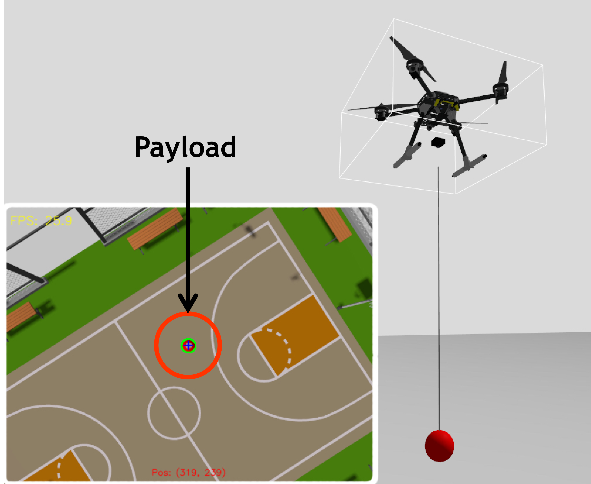
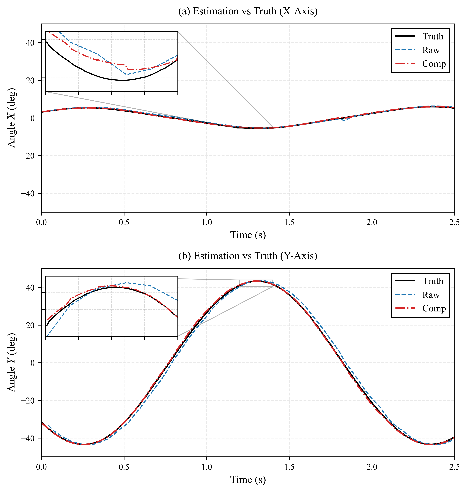
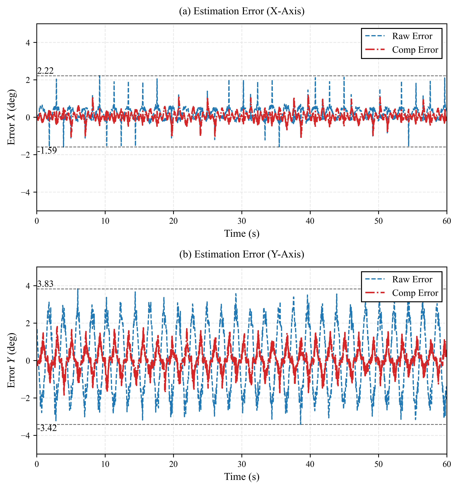
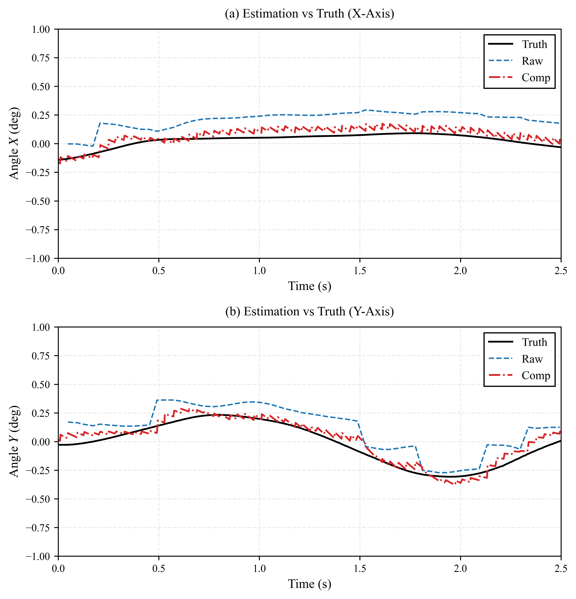
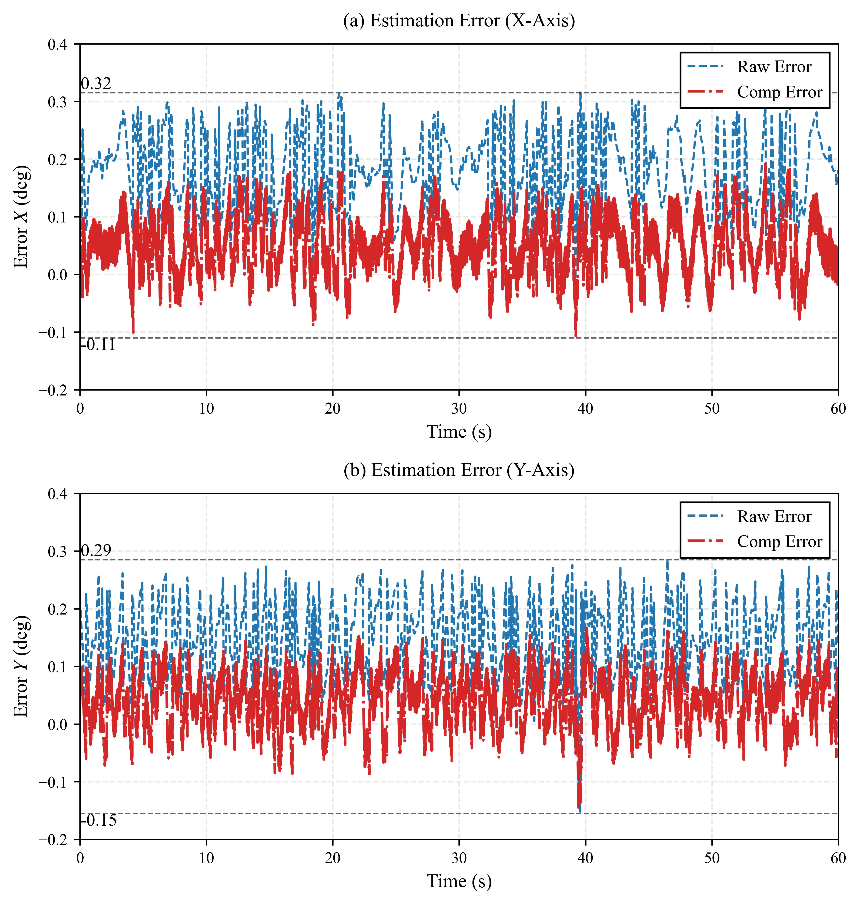
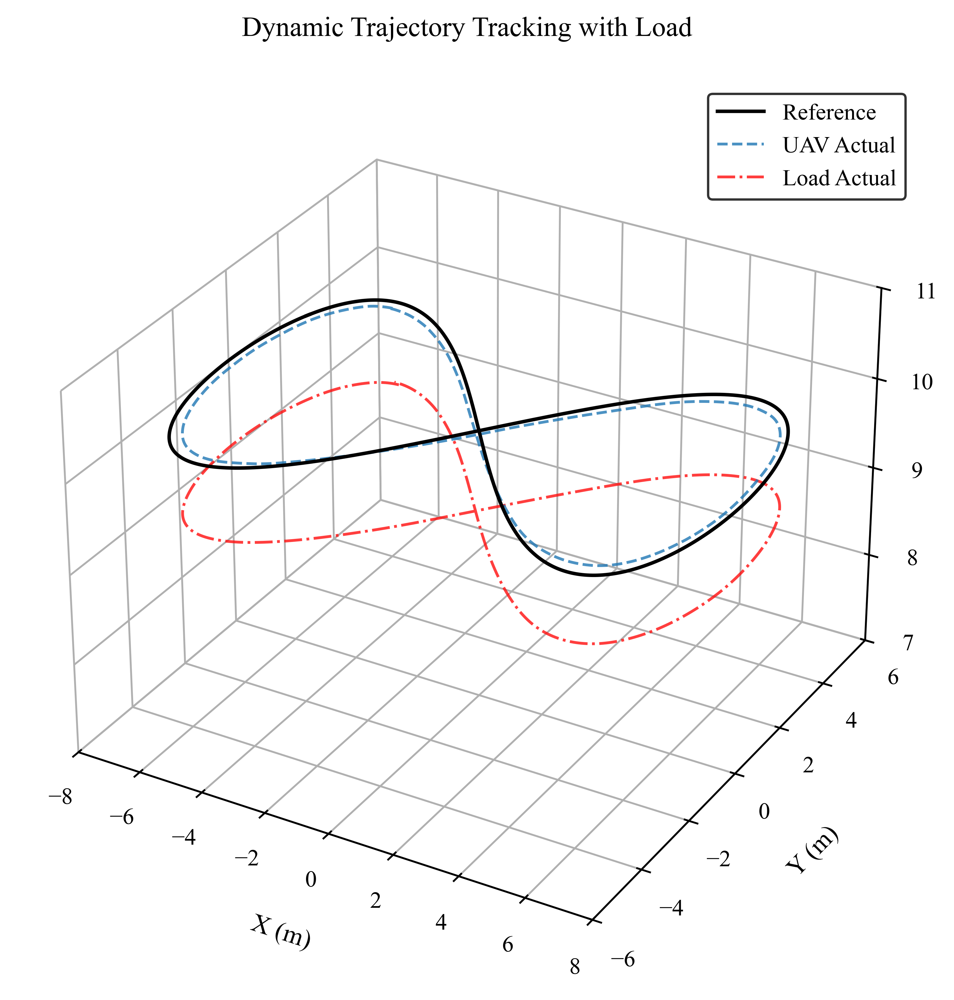
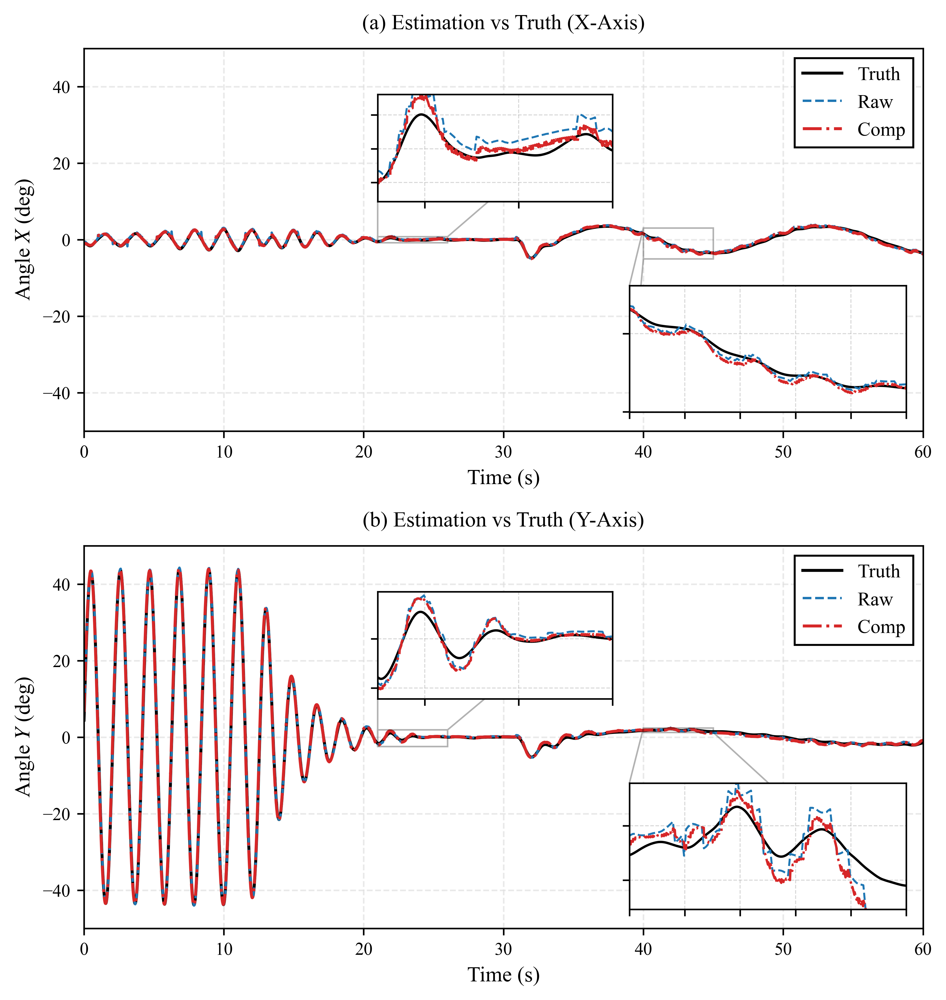

# Swing Angle Estimation and Control with Onboard Vision Delay Compensation
# 基于机载视觉延时补偿的摆角估计与控制

## Abstract （摘要）
&emsp;&emsp;多旋翼吊挂系统因强耦合与欠驱动特性，其载荷抑摆控制是保障飞行安全的核心难题。基于机载视觉摆角测量是一种轻量化的非接触式方案，但相机刚性固连安装引发的“视场姿态耦合”以及图像处理带来的延时，极易导致闭环系统振荡失稳。针对上述痛点，本文提出了一种基于机载视觉延时补偿的估计与闭环控制方法。首先，提出了基于引力对齐的姿态解耦策略，将机体系观测向量实时映射至惯性空间，从根本上剔除了机体姿态波动引入的伪摆角干扰；其次，构建了基于非线性动力学模型的多速率前向预测器，利用高频（200Hz）机载运动学状态推演低频（25Hz）视觉数据，有效克服了系统的相位滞后与零阶保持效应。最后，在 Robot Operating System 2(下文简称 ROS 2) 与 Gazebo 的高保真物理仿真中表明：所提方法的摆角估计均方根误差（RMSE）较无预测补偿方案显著降低了 66.71%。在复杂三维“8”字形轨迹跟踪中，该方法为系统提供了无相移、低噪声的高保真反馈，将最大摆角约束在 $\pm 3.51^\circ$ 的区间内，大幅提升了多旋翼吊挂飞行的动态稳定性与作业安全性。
**Keywords:** Multi-Rotor UAV, Slung-Load, Swing Angle Estimation, Onboard Vision, Delay Compensation, Forward Prediction
**关键词：** 多旋翼无人机、吊挂载荷、摆角估计、机载视觉、延时补偿、前向预测

## I. Introduction （引言）
### A. Background （研究背景）
&emsp;&emsp;随着低空经济与无人飞行器技术的快速发展，旋翼无人机凭借垂直起降能力与高机动性，在应急救援、物流配送、海洋拖拽等领域具备广阔应用前景。
&emsp;&emsp;在多旋翼无人机吊运系统中，相较于固定载荷仓或机械臂夹持，吊绳悬挂运输方式对负载体积无严格限制、机械成本低，任务适配性更强。旋翼无人机本身具有典型欠驱动特性，尤其是引入悬挂负载后，系统自由度增加、状态耦合强烈，复杂机动或外部风扰极易引发负载剧烈摇摆，这不仅会降低运输效率，其产生的反作用力矩更会严重威胁飞行安全，因此高效的摆角抑制是多旋翼吊挂系统实用化必须解决的问题。输入整形、轨迹规划等开环控制方案已被广泛提出，但该类方法对系统参数偏差与外部环境干扰较为敏感，鲁棒性较差。反观基于摆角状态反馈的闭环控制方案，能够有效提升系统的抗干扰能力与抑摆性能，而高精度、高保真、低延迟的负载摇摆状态实时感知，是该类闭环控制方案落地的关键前提。

### B. Related Work （相关工作）
&emsp;&emsp;针对多旋翼吊挂负载的状态感知与抑摆控制，早期研究多聚焦于搭建系统耦合动力学模型，并配套设计对应的飞行控制律。其中，Palunko 等 [1] 探究了无人机吊挂系统的敏捷负载运输与操控策略，实现了复杂工况下的物资转运，为该领域吊挂控制系统的设计与应用奠定了理论基础。Lee 与 Kim [2] 针对多旋翼吊挂飞行的摆动特性，提出了自主摆角估计算法，为吊挂系统闭环稳定控制提供了基础的状态反馈支撑。
&emsp;&emsp;随着机载嵌入式设备算力的迭代与升级，基于机载相机的感知技术，逐步成为多旋翼吊挂负载状态估计的主流方案。Gassner 等 [3] 依托纯视觉感知方式，实现了两架四旋翼无人机协同吊挂运输与作业；Tang 等 [4] 依托视觉反馈控制完成了吊挂无人机激进飞行任务，验证了视觉感知机制在提升吊挂系统动态性能与作业灵活性方面的显著优势。
&emsp;&emsp;但在实际闭环飞行场景中，传统机载视觉感知方案仍存在缺陷：
&emsp;&emsp;视场姿态耦合问题。由于相机与无人机机体刚性固连，机体横滚、俯仰机动动作会直接映射至图像像素运动中，衍生伪摆角干扰，大幅降低摆角观测精度。针对吊挂飞行过程中的外部扰动与模型不确定性问题，Wang 等 [5] 结合视觉-惯性融合策略设计自适应轨迹跟踪算法，提升了吊挂无人机轨迹跟踪的鲁棒性与精度；为解决传统帧式相机动态追踪滞后、成像模糊的问题，Panetsos 等 [6] 将高时间分辨率的事件相机应用于吊挂负载运输作业，有效适配高动态飞行场景，但事件相机硬件成本高昂，显著增加了吊挂系统的部署成本。
&emsp;&emsp;观测延时问题。传统视觉感知流程包含图像采集、数据传输、特征提取等多个环节，会为闭环控制系统引入固定滞后（25Hz 帧率下延时可达数十毫秒）。该时间滞后会造成反馈信号相位偏移，易引发控制器微分项高频抖动，严重时造成系统振荡失稳。针对视觉惯性里程计普遍存在的数据时间偏移、感知延时导致估计精度等问题，Lee 与 Johnson [7] 依托扩展卡尔曼滤波框架，将延时参数辨识融入特征初始化与状态估计全过程，通过在线时间校准与协方差修正实现传感器延时补偿，有效提升了无人机敏捷飞行工况下的状态估计精度。
&emsp;&emsp;综上所述，现有研究分别从动力学模型、视觉感知、多传感器融合、延时补偿等维度优化了吊挂系统作业性能。但在多旋翼吊挂强状态耦合、欠驱动的复杂工况下，现有软硬件方案难以兼顾感知精度、动态抗扰能力与硬件成本。设计一种低成本、高效率的前向预测观测机制，是突破多旋翼吊挂系统飞行性能限制、提升作业稳定性与安全性的关键。

### C. Main Contributions （本文贡献）
&emsp;&emsp;针对上述机载视觉反馈在姿态耦合与数据滞后方面的痛点，本文提出了一种集视觉姿态解耦与动力学前向预测于一体的实时摆角估计与控制方案，旨在为高动态飞行提供无相移、低噪声的高保真状态反馈。
&emsp;&emsp;本文的主要贡献如下：
1. 提出了一种基于引力对齐的固连视觉姿态解耦策略。通过将机体系下的视觉观测向量实时映射至世界坐标系，有效剔除了高机动飞行中无人机姿态剧烈变化对观测产生的“伪摆角”干扰，简化了解算逻辑。
2. 设计了基于动力学模型的多速率前向预测延时补偿方法。针对视觉系统帧率低（25Hz）且存在处理耗时的问题，利用高频（200Hz）的机载运动学状态与系统非线性动力学模型进行状态外推与误差修正，显著抑制了视觉反馈的相位滞后与零阶保持效应。
3. 在具有多段柔性绳索模型的高保真仿真中验证了闭环性能。在 ROS2 与 Gazebo 的 Software In The Loop(下文简称 SITL) 物理仿真环境中，本文所提方法在 $\pm 40^\circ$ 大摆角工况及“8”字形连续动态机动下，均展现出了优异的估计精度与抑摆控制效果。

## II. System Modeling （系统建模）
&emsp;&emsp;本章将建立多旋翼-吊挂系统数学模型来描述无人机运动与载荷摆动之间的动力学耦合关系，并通过坐标变换剔除无人机自身姿态变化对视觉观测产生的“伪摆角”干扰,实现高精度的摆角估计。
### A. Geometric Definitions and System Assumptions （几何定义与系统假设）
&emsp;&emsp;为了实现建模、控制与仿真的统一描述，并在模型准确性与工程实用性之间取得平衡，本文首先明确吊挂系统的标准摆角几何定义及相关物理假设。
结合实际吊运作业的观测与控制习惯，将空间吊绳姿态与无人机运动的对应关系解耦为两个平面：
&emsp;&emsp;纵向摆角 $\theta_x$：吊绳在机体 $X-Z$ 平面内与世界坐标系竖直 $Z$ 轴形成的夹角，反映载荷在无人机前进/后退方向的摆动。
&emsp;&emsp;侧向摆角 $\theta_y$：吊绳在机体 $Y-Z$ 平面内与竖直 $Z$ 轴形成的夹角，反映载荷在无人机左/右方向的摆动。
&emsp;&emsp;结合真实物资吊运工况，本文的动力学推导基于以下合理假设：
&emsp;&emsp;假设 1：吊绳视为理想刚性约束，无质量、无弹性伸长，且长度 $L$ 始终保持恒定。
&emsp;&emsp;假设 2：载荷视为集中质点，忽略其自身体积与转动惯量产生的气动效应，仅考虑平动摆动。
&emsp;&emsp;假设 3：吊绳在整个作业及机动过程中始终保持张紧状态，不出现松弛、缠绕或冲击现象。
&emsp;&emsp;假设 4：载荷摆角幅值被严格约束在 $(-\pi/2, \pi/2)$ 范围内，保证系统动力学模型无奇异性。
&emsp;&emsp;上述假设既保留了系统强耦合、欠驱动的核心特征，又避免了过度复杂的高阶动态，为后续稳定控制器设计提供了坚实基础。
&emsp;&emsp;如图1所示，为四旋翼无人机带吊挂负载系统的坐标系与状态量定义。图中 $O_I - X_I Y_I Z_I$ 表示惯性坐标系；$O_b - X_b Y_b Z_b$ 为固连于无人机质心的机体坐标系，其各轴正向遵循“前-右-下”（FRD）的右手定则。$m$ 为视为质点的吊挂负载。为描述负载的三维空间相对运动，定义 $\theta_x$ 与 $\theta_y$ 分别为悬挂绳索在机体纵向平面（$X_b-O_b-Z_b$）和横向平面（$Y_b-O_b-Z_b$）内的投影摆角。

<figure align="center">
  
  <figcaption>
图1 多旋翼吊挂系统示意图
</figcaption>
</figure>

### B. System Dynamics Model （系统动力学模型）
&emsp;&emsp;以 $X-Z$ 平面为例，设吊挂绳长为 $L$，载荷质量为 $m$，则载荷绕悬挂点的转动惯量为 $I = mL^2$。在飞行过程中，载荷的运动受重力产生的恢复力矩 $\tau_g$、无人机水平加速度 $a_x$ 产生的惯性力矩 $\tau_a$，以及由空气和摩擦引起的等效阻尼力矩 $\tau_c$ 共同作用：
$$\begin{cases}
\tau_g = -mgL\sin\theta_x \\
\tau_a = -ma_xL\cos\theta_x \\
\tau_c = -c\dot{\theta}_x
\end{cases}$$
&emsp;&emsp;其中，$g$ 为重力加速度，阻尼系数 $c$ 包含了空气动力学阻尼、模拟软绳的内部阻尼以及绳索在悬挂点处的摩擦损耗。
根据牛顿-欧拉法与刚体定轴转动定律 $I\ddot{\theta}_x = \sum \tau$，可推导出载荷受迫单摆的非线性微分方程为：
$$\ddot{\theta}_x = -\frac{g}{L}\sin\theta_x - \frac{1}{L}a_x\cos\theta_x - \frac{c}{mL^2}\dot{\theta}_x$$
&emsp;&emsp;考虑到实际软绳的内部摩擦与空气阻尼难以精确测量，本文在工程实现中将 $\frac{c}{mL^2}$ 作为一个综合等效阻尼系数进行参数化处理，微小的参数失配将由后续的视觉闭环反馈机制进行补偿。
&emsp;&emsp;由于系统的物理对称性，在 $Y-Z$ 平面内，无人机在 $Y$ 轴的加速度 $a_y$ 与载荷摆角 $\theta_y$ 的动力学方程同理。该双轴解耦模型建立了无人机机动输入（$a_x$, $a_y$）与载荷摆角响应（$\theta_x$, $\theta_y$）之间的确定性关系。模型中阻尼耗散项的引入，使其能够更真实地反映物理系统的动态衰减过程，这不仅为载荷姿态的观测奠定了基础，更是后续设计前向运动学预测器、有效补偿机载视觉系统固有延时的理论核心。

### C. Onboard Vision Model （机载视觉模型）
&emsp;&emsp;机载单目相机刚性连接于无人机腹部垂直向下观测。根据针孔相机模型，载荷在图像像素坐标系中的位置 $(u, v)$ 与其在归一化相机坐标系下的坐标 $(x_c, y_c)$ 满足以下映射关系：
$$x_c = \frac{u - c_x}{f_x}, \quad y_c = \frac{v - c_y}{f_y}$$
&emsp;&emsp;其中，$(c_x, c_y)$ 为相机的光学主点坐标，$(f_x, f_y)$ 为相机的等效焦距。
&emsp;&emsp;由于相机光轴垂直向下，且图像平面坐标轴与机体轴存在 $90^\circ$ 的空间旋转对应关系，载荷在机体坐标系下的向量 $V_{body}$ 可表示为：
$$V_{body} = \begin{bmatrix} -y_c \\ -x_c \\ -1.0 \end{bmatrix}$$

### D. Gravity Alignment and Attitude Decoupling （引力对齐与姿态解耦）
&emsp;&emsp;由机载相机与安装方式可知，其成像平面时刻随无人机的俯仰、横滚动作发生旋转。在惯性空间下即使载荷保持垂直静止，机体姿态的波动也会导致载荷在图像中的像素坐标产生剧烈偏移。这种“姿态耦合”产生的“伪摆角”信号会严重干扰估计器的收敛。
&emsp;&emsp;本文选择将机体坐标系下的视觉观测向量 $V_{body}$ 映射至世界坐标系（World Frame）进行解耦，其核心优势体现在两个维度：
1. 动力学框架的一致性：系统的受迫单摆动力学方程是在以重力方向为基准的惯性空间中建立的。将视觉数据进行引力对齐，可使观测模型与预测模型的坐标基准直接统一，避免了在非惯性系下引入复杂的牵连加速度补偿。
2. 运算开销的最小化：在机体坐标系下解算摆角时，参考基准（重力向量）随时间动态变化，需实时解算重力向量在机体轴上的分量。而转换至世界坐标系后，重力基准始终保持为常向量 $[0, 0, -1]^T$。在解算三维投影角时，仅需对变换后的 $V_{world}$ 进行简单的分量投影运算，显著降低了高频控制循环中的三角函数运算开销。

&emsp;&emsp;利用 $R_b^w$ 对机体坐标系下的观测方向向量 $V_{body}$ 进行线性变换，得到引力对齐后的世界系方向向量 $V_{world}$：
$$V_{world} = R_b^w V_{body} = \begin{bmatrix} x_w \\ y_w \\ z_w \end{bmatrix}$$
$$R_b^w =
\begin{bmatrix}
1 - 2y^2 - 2z^2 & 2xy - 2z\omega & 2xz + 2y\omega \\
2xy + 2z\omega & 1 - 2x^2 - 2z^2 & 2yz - 2x\omega \\
2xz - 2y\omega & 2yz + 2x\omega & 1 - 2x^2 - 2y^2 \\
\end{bmatrix} $$

&emsp;&emsp;其中，四元数 $q = [\omega, x, y, z]^T$，$R_b^w$ 为机体系到世界系的瞬时旋转矩阵。
&emsp;&emsp;此时$V_{world}$ 已经剥离了机体姿态变化的干扰，真实反映了载荷在惯性空间下的几何位置。该解耦策略不仅符合人类对吊挂运动的直观感知，也为后续基于物理模型的延时补偿估计奠定了数据基础。

## III. Swing Angle Calculation with Delay Compensation （基于延时补偿的摆角解算）
&emsp;&emsp;由于图像采集、数据传输及特征提取算法的计算开销，机载视觉系统不可避免地存在观测延迟，而延时会导致反馈信号的相位滞后，严重时将引发闭环系统发散。本章旨在通过图像处理获取原始摆角观测值，并利用动力学模型进行前向预测，补偿视觉系统引入的系统延时。
### A. Visual-Based Swing Angle Calculation （基于视觉的摆角解算）
&emsp;&emsp;本文利用 OpenCV 库对下视相机捕获的图像进行实时处理。通过 HSV 色彩空间阈值分割提取载荷末端标志物的特征轮廓，并计算其在图像平面的像素质心。随后，利用形态学开闭运算滤除背景噪声，并计算标志物连通域的质心坐标 $(u, v)$。
&emsp;&emsp;结合第 II.C 节推导出的世界坐标系观测向量 $V_{world} = [x_w, y_w, z_w]^T$，利用几何投影关系计算载荷在 $X-Z$ 和 $Y-Z$ 平面内的实时观测摆角：
$$\theta_{xw\_vis} = \arctan\left(\frac{x_w}{-z_w}\right), \quad \theta_{yw\_vis} = \arctan\left(\frac{y_w}{-z_w}\right)$$
&emsp;&emsp;其中，此摆角值 $\theta_{vis}$ 包含了从快门曝光时刻到算法输出时刻的累积延时，记为 $\Delta t$。

### B. Dynamics-Based Forward Swing Angle Prediction （基于动力学的前向摆角预测）
&emsp;&emsp;由于机载计算平台性能限制及图像传输链路开销，从曝光时刻到算法输出结果存在显著的处理耗时 $\Delta t$。若直接将该“过时”的观测值作为控制输入，将引发严重的相位滞后。为消除延时影响，本文利用第 II-A 节建立的非线性动力学模型进行状态外推。设图像触发时刻为 $t-\Delta t$，视觉算法在当前时刻 $t$ 输出的观测值为 $\theta_{vis}(t-\Delta t)$。系统通过记录历史时序内的无人机水平加速度 $a$，利用数值积分方法将摆角状态向未来推进 $\Delta t$ 时间步长：
$$\theta_{pred}(t) = \theta_{vis}(t-\Delta t) + \int_{t-\Delta t}^{t} \dot{\theta} \, d\tau$$
&emsp;&emsp;其中，$\dot{\theta}$ 由动力学微分方程实时解算得到。该过程实现了摆角信号从“过去”到“现在”的对齐，通过物理模型补偿了视觉处理链路产生的滞后。

### C. Compensation and Fusion （补偿与融合） 
&emsp;&emsp;由于动力学模型中阻尼系数 $c$ 和绳长 $L$ 的测量存在不确定性，纯动力学模型预测值 $\theta_{pred}$ 会随时间产生累积漂移。为此，本文设计了时间戳对齐的误差修正机制：当新的视觉观测帧到达时，算法将其与预测器中对应时刻的历史预测值进行对比，产生残差  $e = \theta_{vis} - \theta_{pred}(t - \Delta t)$ 。利用该残差对当前的估计状态进行比例修正：
$$\theta_{comp} = \theta_{pred} + K \cdot e$$
&emsp;&emsp;其中修正增益 $K$ 决定了系统对视觉观测的置信度。通过这种连续预测与离散修正相结合的策略，确保了估计值在具备实时性的同时，依然保持极高的静态与动态精度。

<figure align="center">
  
  <figcaption>
图2 带延时补偿的闭环估计与控制系统框图
</figcaption>
</figure>

&emsp;&emsp;带有前向预测补偿的整体闭环估计与控制系统架构如图 2 所示。

### D. Closed-loop Anti-swing Controller （闭环抑摆控制器）
&emsp;&emsp;为验证本文所提状态估计方法的工程有效性，本文搭建了位置跟踪与负载抑摆双目标闭环控制系统，设计了一种融合速度前馈与摆角反馈的抑摆控制器。控制系统采用分层架构：外环为位置控制环，实现无人机精准位置跟踪；内环结合速度前馈与摆角PD反馈，完成飞行速度调节与负载摇摆抑制。以无人机X轴控制为例，其内环控制律表达式如下：
$$u_{cmd} = v_{ref} + K_p \theta_{comp} + K_d \dot{\theta}_{comp}$$
&emsp;&emsp;式中，$u_{cmd}$ 为无人机机体期望速度指令；$v_{ref}$ 为位置外环控制器输出的参考速度，由位置偏差计算得到，满足 $v_{ref} = K_{pos}(p_d - p)$，其中 $p_d$ 与 $p$ 分别为无人机期望位置与实际位置，$K_{pos}$ 为位置环比例增益；$\theta_{comp}$、$\dot{\theta}_{comp}$ 分别为经过预测补偿后的负载摆角与摆角速度，$K_p$、$K_d$ 分别为摆角反馈比例、微分增益。
&emsp;&emsp;在无补偿的系统中，由于视觉延时的存在，反馈信号与实际状态之间存在较大的相位偏差，极易在大幅度机动时诱发闭环系统的振荡甚至发散。经过预测补偿后的摆角信号基本消除了滞后性，从而增强了系统的阻尼特性，确保了无人机在复杂飞行任务下对载荷摇摆的快速抑制。

## IV. Simulation Analysis （仿真结果与分析）
&emsp;&emsp;为了验证本文提出的固连视觉位姿解耦与延时补偿算法的有效性，本章在具有高保真物理引擎的联合仿真环境中进行了综合测试，并从估计精度、延时消除效果以及闭环飞行控制表现三个维度进行了评估。
### A. Simulation Setup （仿真环境配置）
&emsp;&emsp;仿真平台基于 Ubuntu 22.04 与 ROS 2 Humble 搭建，底层飞控采用 PX4 软件在环仿真（SITL），物理场景与传感器数据由 Gazebo Harmonic 物理引擎实时解算与渲染，二者通过 Micro-XRCE-DDS 实现高频状态数据交互。
&emsp;&emsp;仿真无人机采用标准 X500 四旋翼机架，机体下侧刚性搭载一台向下观测的单目相机，输出帧率设置为工程常用的 25Hz。为充分验证算法在非理想工况下的适配性，仿真未采用传统刚性连杆吊挂假设，而是构建由 20 段独立铰接节点组成的多段柔性绳索模型，绳索末端配置球形负载，能够真实复现吊挂系统强非线性动力学特性，搭建贴近实际工程的高保真仿真场景。本文所采用的柔性绳索吊挂结构与机载下视相机观测视角如图 3 所示。

<figure align="center">
  
  <figcaption>
图3 吊挂系统与相机视角图
</figcaption>
</figure>

&emsp;&emsp;为量化评估估计精度，本文通过订阅 Gazebo 仿真环境中 200Hz 的物理状态话题获取载荷真值。通过实时提取多旋翼机体质心坐标 $\boldsymbol{P}_{uav}$ 与载荷球体质心坐标 $\boldsymbol{P}_{load}$，构造载荷相对于机体的空间位置向量 $\boldsymbol{V}_{truth} = \boldsymbol{P}_{load} - \boldsymbol{P}_{uav}$。再将该向量投影至世界坐标系下的 $X-Z$ 与 $Y-Z$ 平面，利用几何三角关系解算出摆角真值。由于该数据直接来源于仿真引擎的刚体动力学解算器，未包含视觉感知环节的噪声与延时，故可作为评估算法性能的理想基准。
&emsp;&emsp;涵盖底控制、物理渲染与高频状态同步的软件在环（SITL）联合仿真架构如图 4 所示。

<figure align="center">
  
  <figcaption>
图4 仿真系统架构图
</figcaption>
</figure>

### B. Open-Loop Swing Angle Estimation Performance （开环摆角估计性能评估）
&emsp;&emsp;为量化评估所提估计算法的精度与延时补偿性能，本文首先在定点悬停模式下进行了开环对比测试。在未开启闭环抑摆控制器的前提下，给无人机施加水平机动扰动，使载荷在空间内产生幅值约 $\pm 40^\circ$ 的大范围自由摆动，以充分激发系统的非线性与延时特征。
&emsp;&emsp;如图 5 所示，自由摆动状态下展示了视觉原始解算摆角（Raw）、补偿后估计摆角（Comp）与物理引擎真值（Truth）的时域对比。可以清晰观察到，受限于 25Hz 的视觉采样率及图像处理的固有耗时，原始视觉解算曲线在波峰与波谷处显著滞后于真实摆角。这种由于传输与计算带来的纯滞后，若直接引入闭环控制，将提供错误相位的阻尼反馈。而经过基于动力学模型的前向预测补偿后，Comp 曲线在相位上实现了与真值的精准对齐，且在 $\pm 40^\circ$ 的大角度非线性区域依然保持了极高的轨迹拟合度。

<figure align="center">
  
  <figcaption>
图5 悬停扫频X/Y对比图
</figcaption>
</figure>

&emsp;&emsp;结合图 6 的绝对误差曲线进一步分析可知，无补偿的原始视觉观测在动态剧烈变化时，其追踪误差在 Y 轴被放大至近 $3^\circ$。而采用补偿算法后，即使在最大摆动速度的过零点区域，Comp Error 仍被稳定约束在 $\pm 1.5^\circ$ 的窄带范围内。定量表现上，误差幅值得到了显著抑制，证明了该算法在消除相位延时与提升大动态观测精度上的有效性。

<figure align="center">
  
  <figcaption>
图6 悬停扫频X/Y误差图
</figcaption>
</figure>

表1 吊挂姿态补偿效果对比表

| Evaluation Metric | CV Raw (Uncompensated) | CV Comp (Proposed) |
|:---:|:---:|:---:|
| Max Absolute Error ($^\circ$) | 3.80 | 2.08 |
| Root Mean Square Error ($^\circ$) | 1.84 | 0.61 |

&emsp;&emsp;表 1 统计了不同状态下的最大绝对误差（Max Error）与均方根误差（RMSE）。定量数据表明，经过预测补偿与误差修正后，摆角估计的 RMSE 较原始视觉结果下降了 $66.71\%$，证明了该估计算法具有高保真的稳态与动态精度。

### C. Anti-swing Closed-loop Verification （闭环抑摆控制验证）
&emsp;&emsp;为了进一步验证高保真状态反馈对飞行控制的增益，本文在相同的初始扰动下，接入了基于速度前馈的闭环抑摆控制器，并考察系统在微小扰动抑制阶段的高频特性。

<figure align="center">
  
  <figcaption>
图7 悬停抑摆X/Y对比图
</figcaption>
</figure>

&emsp;&emsp;如图 7 所示，采用补偿后摆角作为反馈信号的控制系统，不仅避免了启动初期的剧烈振荡，还能将载荷摆动迅速收敛并限制在 $\pm 0.5^\circ$ 的极小安全区域内。更为关键的是，在此极小角度区间内，25Hz 的原始视觉信号（Raw）由于分辨率与低频采样的限制，呈现出严重的“阶梯状”零阶保持效应。这种离散的阶跃跳变包含丰富的高频噪声，若直接代入控制器的微分项（$K_d$），极易导致无人机电机的高频震颤与系统失稳。而本文提出的前向预测补偿器，利用 200Hz 的连续高频运动学状态向前推演 ，在填补视觉采样间隙的同时进行平滑修正。从图 7 中可明显看出，Comp 曲线在消除滞后的同时，彻底滤除了阶梯状的离散噪声，恢复了物理信号原有的连续与平滑特性。

<figure align="center">
  
  <figcaption>
图8 悬停抑摆X/Y误差图
</figcaption>
</figure>

&emsp;&emsp;对比图 8 的闭环误差曲线，Raw 信号因阶梯跳变带来的瞬态误差高达 $0.3^\circ$，而 Comp 误差则被平稳地压制在 $0.1^\circ$ 以内。该结果表明，本文所提方法不仅解决了大动态下的延时滞后问题，更为高增益闭环控制器提供了低噪声、无相移的高频平滑反馈，是实现安全、高效抑摆飞行的核心保障。

### D. Dynamic Trajectory Tracking Verification （动态轨迹跟踪验证）
&emsp;&emsp;为了进一步验证估计算法在连续大动态工况下的性能，本节开展了三维空间下的“8”字形轨迹跟踪测试。参考轨迹采用伯努利双纽线（Bernoulli lemniscate）生成，无人机在锁定基准起飞高度的前提下执行连续机动。相比于定点悬停，该轨迹包含了持续交变的向心加速度与切向加速度，这种连续的动态激励会对载荷产生复杂的非线性扰动，从而对估计算法的动态跟踪能力提出了更为严苛的要求。

<figure align="center">
  
  <figcaption>
图9 8字动态轨迹跟踪图
</figcaption>
</figure>

&emsp;&emsp;图 9 展示了三维空间下的轨迹跟踪表现。在采用本文提出的摆角反馈方案后，无人机的实际飞行轨迹（UAV Actual）与载荷实际轨迹（Load Actual）能够有效跟踪参考路径（Reference）。这一宏观表现印证了系统在复杂机动下具备良好的稳定性。

<figure align="center">
  
  <figcaption>
图10 8字飞行动态摆角跟踪对比图
</figcaption>
</figure>

&emsp;&emsp;图 10 详细展示了 8 字飞行过程中的摆角状态。在连续变加速运动中，载荷的惯性摆动被持续激发，常规视觉解算受限于采样率和计算耗时，极易产生相位偏离。而本文算法依靠前向动力学模型与延时补偿机制，使得补偿后的估计摆角（Comp）在整个动态周期内始终与物理真值（Truth）保持高度贴合，未出现明显的积分漂移现象。正是得益于这种高保真、无相移的实时角度反馈，闭环抑摆系统能够准确获取载荷状态并及时输出阻尼指令，将动态机动激发的最大摆角稳定收敛并约束在 $\pm 3.51^\circ$ 的安全区间内。
&emsp;&emsp;实验结果表明，所提估计算法不仅在静态抗扰中表现优异，在持续的复杂空间机动下依然具备高精度的状态估计能力，为多旋翼吊挂系统的安全作业提供了可靠支撑。

## V. Conclusion （结论）
&emsp;&emsp;本文提出一种基于机载视觉延时补偿的摆角估计与闭环抑摆控制方法，有效剔除了机体姿态扰动对视觉观测的耦合干扰，实现对低频视觉滞后信号的精准状态外推与高频平滑滤波。基于 ROS 2 与 Gazebo 高保真物理引擎的联合仿真结果表明，所提方法能够为吊挂系统提供低延时、高保真的摆角状态反馈，可在保障飞行安全的前提下，快速抑制负载摆动。
&emsp;&emsp;本文所提方案在非线性柔性吊挂仿真场景中表现出良好的估计与抑摆性能，但仍存在一定局限。一方面，系统闭环估计带宽受限于相机原生帧率（本文设置为 25Hz），面对更高频率的负载扰动与机体振荡时，动态响应速度仍有进一步提升空间；另一方面，现阶段算法仅在含多段柔性绳索模型的软件在环（SITL）仿真环境中完成闭环验证，尚未开展真实户外场景的实物飞行实验，后续仍需依托实际平台进一步校验算法工程适用性。

## References
[1] I. Palunko, P. Cruz, and R. Fierro, "Agile load transportation: Safe and efficient load manipulation with aerial robots," IEEE Robotics & Automation Magazine, vol. 19, no. 3, pp. 69-79, 2012.
[2] S. J. Lee and H. J. Kim, "Autonomous swing-angle estimation for stable slung-load flight of multi-rotor UAVs," in Proc. IEEE International Conference on Robotics and Automation (ICRA), pp. 4576-4581, 2017.
[3] M. Gassner, T. Cieslewski, and D. Scaramuzza, "Dynamic collaboration without communication: Vision-based cable-suspended load transport with two quadrotors," in Proc. IEEE International Conference on Robotics and Automation (ICRA), pp. 5196-5202, 2017.
[4] S. Tang, V. Wüest, and V. Kumar, "Aggressive flight with suspended payloads using vision-based control," IEEE Robotics and Automation Letters, vol. 3, no. 2, pp. 1152-1159, 2018.
[5] S. Wang, H. Chen, J. Liu, et al., "Adaptive trajectory tracking of UAV with a cable-suspended load using vision-inertial-based estimation," Automatica, vol. 158, p. 111310, 2023.
[6] F. Panetsos, G. C. Karras, and K. J. Kyriakopoulos, "Aerial transportation of cable-suspended loads with an event camera," IEEE Robotics and Automation Letters, vol. 9, no. 1, pp. 231-238, 2023.
[7] K. Lee and E. N. Johnson, "Latency compensated visual-inertial odometry for agile autonomous flight," Sensors, vol. 20, no. 8, p. 2209, 2020.