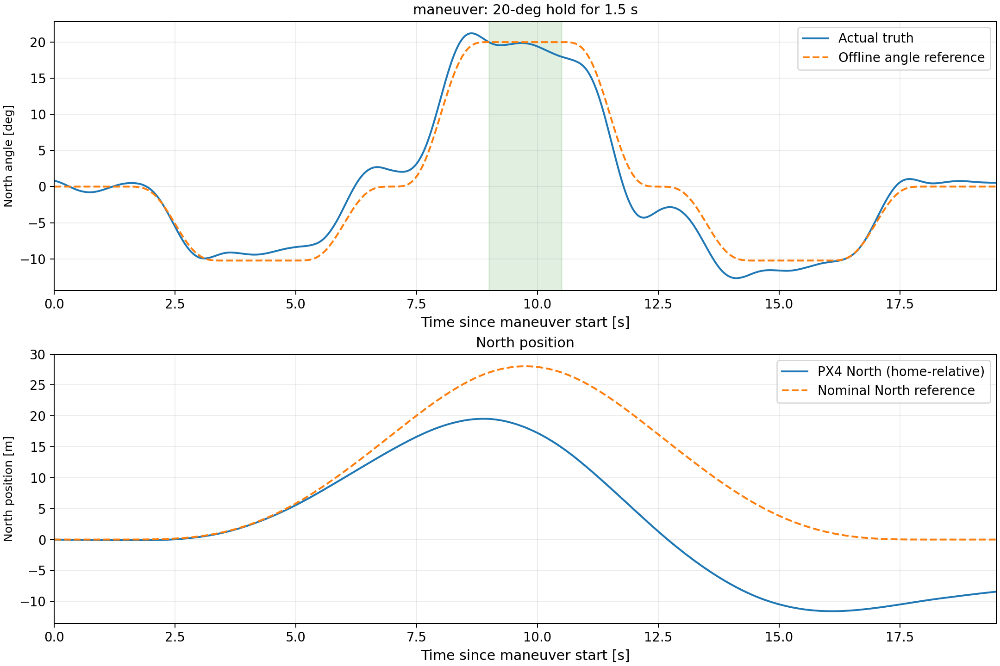

<!-- Codex-generated document: consolidated angle-task methodology, implementation and validation, 2026-10-25. -->
# 吊挂摆角跟踪与短时定角：计算方法、实现及改进方向

当前方案的基本思路是：**先规定吊载应该怎样摆动，再利用动力学反算飞机的运动和加速度指令，运行时通过观测器反馈修正误差。**现阶段采用离线参考表、模型前馈和误差反馈，已实现定频正弦摆角跟踪与短时非零摆角维持。

需要区分两件事：原观测器、C++控制器源码及基准配置保持不变；但角度实验层增加了前馈、摆角误差反馈和参考输入换算，**角度实验的实际闭环结构已经不同于原来的悬停抑摆控制**。

## 1. 当前实现了什么

| 项目 | 当前设置 |
|---|---|
| 已复验链路 | ESO_delay＋ADRC；PX4估计状态及观测器用于控制，Gazebo真值不进入在线控制，用于离线校准与评价 |
| 运动范围 | North竖直平面，起飞点上方8 m，绳长1 m |
| 航向 | 角度任务暂时固定起始航向；八字仍保持切向偏航 |
| `sweep` | ±30°、0.45 Hz，周期约2.22 s；平滑启动后持续重复 |
| `maneuver` | +20°维持1.5 s；完整离线参考19.5 s，定角段位于第9–10.5 s |
| 更新方式 | 任务层以50 Hz读取并插值参考表；观测器保持原有200 Hz输出 |
| 实验入口 | `angle.launch.py`；原基准入口仍为`offboard.launch.py` |

`sweep`是沿用的命令名，当前实际功能是**定频正弦跟踪**，频率不随时间变化。此前仅用QGC悬停时出现的自由摆动，也不能作为受控扫频实验。

## 2. 轨迹怎样计算

### 2.1 从摆角反算挂点运动

在高度近似不变、绳长固定的单平面模型中，摆角与挂点水平加速度满足：

$$
l\ddot{\theta}+g\sin\theta=-a_h\cos\theta
$$

因此，给定目标摆角及其导数，可以得到理想挂点加速度：

$$
a_{h,r}=-\frac{l\ddot{\theta}_r+g\sin\theta_r}{\cos\theta_r}
$$

其中，$l$为绳长，$\theta_r$为目标摆角，$a_{h,r}$为目标挂点加速度，正方向沿用工程定义。对加速度积分可得到挂点速度和位置，再根据挂点与机体参考点的偏置换算出机体的名义运动参考。

位置与摆角在这里存在动力学约束，不能分别任意指定。尤其是维持非零摆角时，即使摆角不再变化，飞机仍需要持续提供水平加速度：

$$
a_{h,r}=-g\tan\theta_r
$$

20°对应的理想加速度幅值约为3.57 m/s²，30°则约为5.66 m/s²。这也是当前短时定角选择20°的原因之一。

### 2.2 定频正弦跟踪

稳态目标为：

$$
\theta_r(t)=30^\circ\sin\!\left(2\pi\times0.45\,(t-t_s)\right)
$$

$t_s$表示所选的周期相位起点。启动时使用平滑包络逐渐建立振幅，并调整启动段的速度，使其能够接入后续周期。约14.44 s后进入重复段；表中只保存启动段和一个完整周期，运行时循环读取，保证周期接缝处的位置、速度、摆角及相应导数一致。

1 m绳长的小角度自然频率约为0.50 Hz。0.45 Hz略低于这一频率，在当前模型中可以用较小的挂点运动维持明显的吊载摆动。

### 2.3 短时定角

`maneuver`不是直接把目标从0°跳到20°，而是按以下过程执行：

**平滑预摆约−10.24° → 进入+20°并维持1.5 s → 反向回收 → 结束。**

预摆和回收用于调整系统的速度与位移。离线计算通过求解反向摆动幅值，使名义轨迹满足起止位置、速度条件；再加入平滑过渡，得到完整19.5 s参考。

这些边界条件在近似模型中成立，不代表实际飞机必然精确回到原位置。当前实际定角任务结束后，还会通过停止与返航流程回到起飞点。

## 3. 从理想轨迹到实际控制

### 3.1 离线前馈与运行时读取

理想挂点加速度不能直接等同于PX4实际产生的加速度。因此，离线计算还使用了当前仿真执行链路的辨识模型，近似考虑增益、动态滞后及挂点偏置，将理想运动转换为指令前馈。

正弦前馈额外做过一次0.45 Hz下的幅值、相位校准。因此，当前单频精度既包含模型和反馈的作用，也包含该频点的校准贡献，不能直接外推为所有频率下的性能。

参考表保存位置、速度、物理加速度、摆角、角速度、角加速度和指令前馈。运行时对位置和角度采用五次Hermite插值，对前馈采用线性插值，再结合当前观测状态计算控制输入。正常任务读取离线表，停止时根据当前状态生成局部过渡段。实现入口为`angle_console.py`，两类参考表分别为`angle_sine.csv`和`angle_hold.csv`。它属于**模型逆解前馈＋误差反馈**，不是反步控制或通用在线规划器。

### 3.2 控制器究竟有没有改变

原C++ ADRC/PD源码、观测器及基准配置没有被重写；但角度实验层通过换算位置参考输入，等效替换了North方向原有的摆角归零反馈，加入目标摆角跟踪。原ADRC扰动补偿通道仍保留，East和高度方向沿用原链路。

以当前ESO_delay＋ADRC为例，令误差为“实测或估计值减参考值”，North方向的等效指令可概括为：

$$
a_{N,\mathrm{cmd}}\approx\operatorname{sat}\!\left[
 u_{\mathrm{ff}}
 +k_\theta(\hat\theta-\theta_r)
 +k_\omega(\hat{\dot\theta}-\dot\theta_r)
 -k_x(x-x_r)-k_v(v-v_r)+u_f
\right]
$$

$u_{\mathrm{ff}}$为离线前馈，$u_f$为原ADRC保留的扰动补偿贡献；最终输出仍经过限幅。这里的加速度指令也不等于飞机瞬时实际加速度，两者之间仍有PX4执行动态。

| 实验层设置 | 当前值 | 作用 |
|---|---:|---|
| 摆角误差增益 $k_\theta$ | 2.0 | 修正摆角偏差 |
| 角速度误差增益 $k_\omega$ | 1.2 | 修正角速度偏差 |
| 正弦位置／速度纠偏 $k_x/k_v$ | 0.15／0.7 | 抑制长期漂移 |
| 定角位置／速度纠偏 $k_x/k_v$ | 0／0 | 整个有限任务优先跟踪摆角 |
| 角度实验水平加速度限幅 | 各轴±4.5 m/s² | 角度实验入口的现有设置 |
| 原基准水平加速度限幅 | 各轴±3 m/s² | 原基准入口保持不变 |

角度及角速度在控制计算中分别使用rad和rad/s，显示与绘图使用°。实验层设置位于`feedback.yaml`。

### 3.3 为什么位置曲线仍有较大偏差

当前有限定角任务的North位置和速度纠偏均为0，因此图中的橙色位置曲线是**名义运动参考，没有被强制跟踪**。实际加速度、角度跟踪误差和模型误差在积分后，也会形成速度与位置偏差。

这说明当前实现优先保证摆角，尚未同时实现精确的位置跟踪。不能仅凭摆角接近目标，就认为整条位置轨迹也已准确执行；也不能简单加大位置增益，否则位置目标与摆角目标可能互相干扰。

## 4. 当前实验结果怎样理解

| 实验 | 结果及统计范围 |
|---|---|
| 最新20°定角段 | 第9–10.5 s真值均值19.37°，标准差0.56°，平均偏差约−0.63° |
| 最新完整定角参考 | 原19.5 s任务内的摆角跟踪RMSE约1.86°，包含预摆、进入与回收过程 |
| 最新任务末端附近位置 | 实际North约−8.42 m，名义参考约0 m；尚未计入后续自动返航 |
| 此前0.45 Hz正弦稳态验证 | 60个周期；基波幅值约30.15°，跟踪RMSE约0.19°；统计排除启动段及最初两个重复周期 |

上述结果均在相同任务时间比较，没有通过平移曲线或去均值美化误差。定角段的标准差、定角平均偏差和完整任务RMSE是不同指标，不应混用。



最新图只包含原19.5 s任务，未混入后续制动与返航参考。图像为`maneuver_20deg.png`，绘图程序为`plot_maneuver.py`。实验原始数据及精简绘图数据保存在工程外的本轮临时目录中。

## 5. 提高精度的优先顺序

**第一步：核对前馈、实际执行与扰动补偿。**记录前馈指令、PX4实际加速度、反馈修正量和扰动补偿贡献，区分偏差来自执行模型、扰动通道还是反馈能力。优先修正定角前馈及进入、回收过程，不直接给真值或测量曲线加固定偏置。

**第二步：小范围调整实验层的摆角、角速度误差增益。**同时评价定角平均偏差、跟踪RMSE、过冲和指令饱和。由于North原归零反馈已被等效替换，应优先调整实验层的2.0、1.2及相关前馈，不能直接套用原基准ADRC的`omega_c、zeta`寻优结论。

**第三步：需要位置与摆角兼顾时，联合设计参考和控制。**先做离线联合规划，将摆角、位置、速度、终端条件和加速度约束放在同一个问题中，再设计相容的误差反馈。现阶段不必立即引入复杂的在线规划器，也不应只把位置增益简单加回去。

观测器当前保持冻结，优先研究前馈、任务过渡和位置—摆角耦合。是否进一步调整观测器，应由新的误差证据决定。

## 6. 启动与停止规则

按原流程加载ROS环境、保持QGC连接，在三个终端分别启动：

```bash
ros2 launch slung_ctrl sim.launch.py
ros2 launch slung_ctrl estimation.launch.py estimator:=all
ros2 launch slung_ctrl angle.launch.py
```

角度实验终端与原`offboard.launch.py`二选一，不同时控制飞机。`takeoff`完成并在8 m原点稳定后，再输入`sweep`或`maneuver`。

| 命令 | 当前语义 |
|---|---|
| `pause` | 八字保存进度并平滑停下；角度任务取消当前工作并平滑停下，均保持抑摆 |
| `resume` | 只恢复保存的位置任务；不恢复`sweep`或`maneuver` |
| `control off` | 停稳后才允许关闭抑摆，位置控制继续；无需`control on` |
| `reset` | 清除任务、进度和暂停记录，平滑停止并就近悬停，自动开启抑摆 |
| `home` | 清除工作，平滑停止后返回本次起飞完成点，自动开启抑摆 |

角度任务停止后，先`home`，稳定后重新输入原命令，从完整起始段开始。停止过程先收回角度参考，再依据实际位置和速度制动，可能包含反向摆动，不是瞬间驻停。本轮复验中正弦约8.1 s、定角约12.2 s停稳；具体时间随状态与触发相位变化。

复验已覆盖八字暂停恢复、角度任务取消重启、control off、reset、home、人工Hold接管恢复和降落上锁。其他观测器／控制器组合未按本轮流程全部复验。实验原始数据与临时程序均位于工程外标记为`DELETE_ME`的目录，工程内保留参考、说明、图片和绘图程序。
