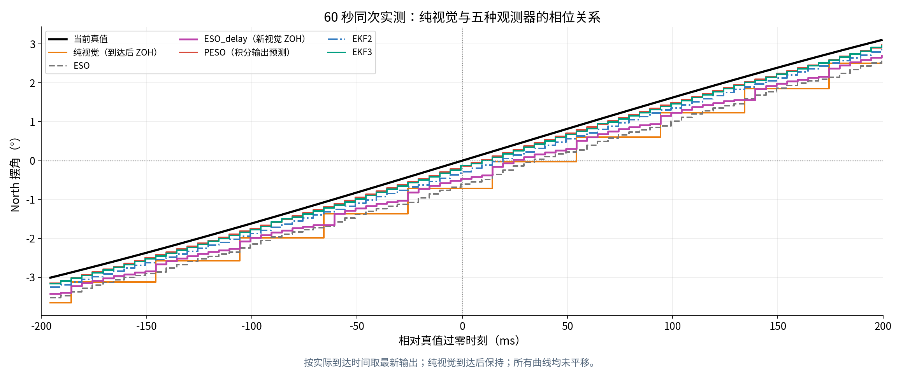
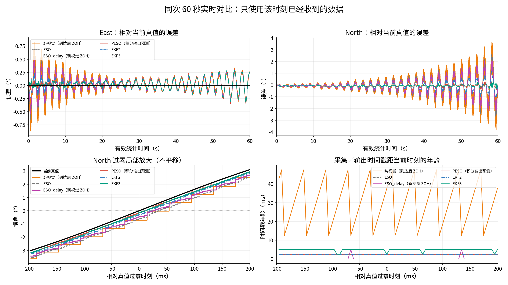

<!-- Codex-generated: owner-approved basic PESO, SI interface migration and measured comparisons, 2026-10-27. -->
# 五种观测器对照说明

## 处理流程与单位

所有方法均估计 East／North 两个方向。消息与内部计算统一使用 **rad、rad/s、rad/s²**；终端、报告和图片显示为 °、°/s。视觉采集 25 Hz，观测器名义输出 200 Hz。

| 方法 | 状态与处理流程 | 时间处理 |
|:---:|---|---|
| `eso` | 线性单摆模型；摆角、角速度、扰动；视觉 ZOH＋RK4 | 使用最新收到的视觉与加速度，不做时间对齐或延迟补偿 |
| `eso_delay` | 相同 LESO 模型和增益；历史视觉 ZOH | 按采集时刻推进历史锚点，再用新视觉 ZOH 与历史加速度回放至当前 |
| `peso` | 相同 LESO 模型和增益；增加内部摆角预测量，由估计角速度积分推进 | 沿用历史对齐与回放；新视觉只重置对应采集时刻的预测起点，再联合推进至当前 |
| `ekf2` | 两状态非线性 EKF，无固定阻尼；RK4、共有噪声与校正方式对齐 EKF3 | 视觉到达后直接校正当前状态，无显式时间补偿 |
| `ekf3` | 三状态非线性 EKF；摆角、角速度、扰动及协方差 | 在采集时刻校正历史状态，重传播到当前 |

EKF2／EKF3 用于比较扰动增广与时间处理的整体收益；ESO_delay／PESO 主要比较 ZOH 与帧间输出预测。原有算法、控制律和全部基准配置值保留，本轮只迁移收发单位并新增 PESO。

## 初版 PESO

内部预测摆角记为 $p$，其更新为：

$$
\dot p=\hat\omega,\qquad p(t_k^+)=\theta_v(t_k),\qquad e=p-\hat\theta.
$$

将 $p$ 替代原来的视觉 ZOH，误差 $e$ 进入原 LESO 校正项。预测量与三项 ESO 状态使用同一 RK4 联合积分；新视觉到来时，只重置预测量，三项 ESO 状态保持连续。历史锚点更新和当前输出回放都采用这一方式，发布结果不改写锚点，也不重复融合同一帧。

例如视觉 90 ms 到达、采集于 65 ms：先沿上一帧的预测推进至历史 65 ms，再以真实视觉重置 $p$，结合 65–90 ms 的加速度和估计角速度联合回放到当前。相机仍是 25 Hz，帧间新增的是模型预测信息。

PESO 配置与 ESO_delay 完全一致：带宽 **8 rad/s**、最大积分步长 **0.005 s**、绳长 **1 m**。本版保留线性名义模型及其扰动残差定义，没有新增积分纠偏增益、滤波或角度限制。

## 本轮自由摆动实测

2026-10-27，使用工程外固定场景快照与相同 PX4 参数种子，8 m PX4 Hold，未开启本项目抑摆控制；不加风、额外延迟或降帧。进入 Hold 后排除前 5 s，统计连续 60 s。

真值峰值 E/N 为 **6.00° / 25.34°**。以 200 Hz 网格比较当时实际已收到的最新输出与当前真值；只有真值按采集戳插值，误差与曲线不平移、不去偏置。

| 输出 | 实时摆角 RMSE，E/N [°] | North 等效相位滞后 [ms] |
|:---:|:---:|:---:|
| 纯视觉 | 0.159 / 0.732 | 31.0 |
| ESO | 0.144 / 0.670 | 30.0 |
| ESO_delay | 0.132 / 0.533 | 24.0 |
| PESO | 0.102 / 0.089 | 1.0 |
| EKF2 | 0.105 / 0.254 | 11.0 |
| EKF3 | 0.100 / 0.089 | 1.0 |

PESO 的 North 摆角 RMSE 相比 ESO_delay 降低约 **83%**；角速度 RMSE 由 **1.258°/s** 降至 **0.351°/s**。角速度参考由高频真值角度数值求导得到。

相位滞后采用去均值相关搜索，步长 0.5 ms，正值表示落后真值；这是本次运动下的等效相位指标，不是固定通信延迟。时间戳年龄与相位滞后分开评价，输出标记当前时刻不代表误差或滞后必然为零。

## 两圈八字复验

两组分别使用 ESO_delay＋ADRC、PESO＋ADRC；均使用同一场景快照、模型出生设置、PX4 参数种子、原八字轨迹和 `control_eso.yaml`。各组起飞到 8 m 后执行两圈八字，PESO 只在稳定起飞点切入。启动动力学和传感器存在小幅差异，以下为单次成对复验，统计包含平滑入轨。

**同次输入比较：** 在 ESO_delay＋ADRC 飞行中，两者同步估计：

| 输出 | 实时摆角 RMSE，E/N [°] |
|:---:|:---:|
| ESO_delay | 0.043 / 0.075 |
| PESO | 0.036 / 0.061 |

**独立闭环比较：**

| 反馈观测器 | 真实摆角 RMS，E/N [°] | 水平跟踪 RMSE [m] | 水平指令 RMS [m/s²] |
|:---:|:---:|:---:|:---:|
| ESO_delay | 1.733 / 1.126 | 1.016 | 0.371 |
| PESO | 1.727 / 1.146 | 1.015 | 0.370 |

本轮估计精度改善，原控制参数下的真实摆动与跟踪效果基本持平。水平跟踪误差由终端同期位置与参考位置计算，摆角为相对竖直方向的真实角度。

编译、五种观测器 SI 消息检查、耦合 RK4 与历史回放测试通过；角度任务参考消息和显示转换通过回归检查。三次飞行均正常降落上锁，飞行期间无 failsafe 或观测器复位；另复验了稳定原点处 PESO＋PD、EKF2＋PD 的切换与悬停。正弦和定角未在本轮重新飞行。

## 启用与数据

`estimation.launch.py estimator:=all` 现在同时启动五种观测器；也可单独选择 `estimator:=peso`。交互终端在稳定起飞点执行 `estimator peso`，沿用原控制配置，默认启动选择为 `peso`，配套 ADRC；其余观测器仍可在起飞点手动切换。

`SwingADRCState` 的摆角、角速度字段已改为 `_rad`、`_rad_s`；所有节点需使用同一轮编译结果并重启，旧度制录包需显式换算。PlotJuggler 的原始 ROS 曲线为弧度，显示为角度时应用曲线转换 `return value * 180 / math.pi`；终端已自动转换。

临时源码备份、仿真快照、数据和绘图程序均位于工程外 `/tmp/UAV_slung_PESO_20261027_DELETE_ME/`，标记待删除；工程内仅更新本说明及已有两张图片。
