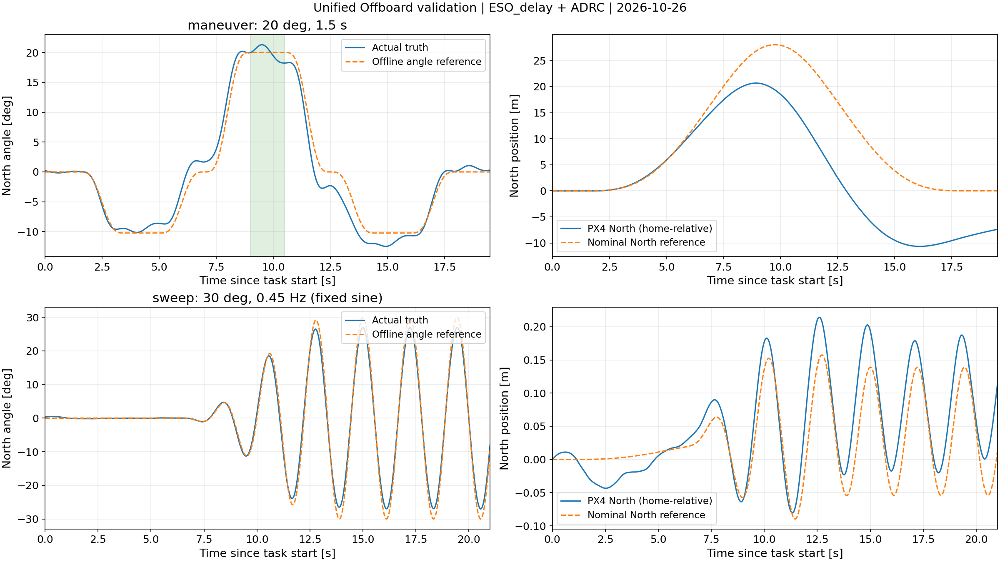

<!-- Codex-generated document: plain-language angle-task explanation, updated 2026-10-26. -->
# 正弦摆动与短时定角：
> **根据吊挂系统和现有控制链路的响应，提前离线推导飞机运动轨迹，再控制小球以指定方式摆动。**

## 1. 两个任务

| 命令 | 目标 | 执行方式 |
|---|---|---|
| `sweep` | ±30°、0.45 Hz的正弦摆动，周期约2.22秒 | 逐渐增大摆幅，约14.44秒后进入重复段，一直运行到手动停止 |
| `maneuver` | 20°维持1.5秒 | 先向反方向预摆，再进入20°，最后回收；整段参考19.5秒，维持段在第9–10.5秒，结束后自动制动、回原点 |

这里的`sweep`沿用旧命令名，实际是**固定频率正弦跟踪**，没有逐渐改变频率。它与只用QGC悬停时出现的自由摆动不同：这次有明确的目标波形。

两种角度任务都在8 m高度、North方向执行，暂时固定起始航向；八字仍然让机头跟随运动方向。

## 2. 轨迹怎么算出来

先规定小球的目标摆角随时间怎么变化，再通过摆的动力学算出挂点需要的水平加速度，积分得到速度和位置，并考虑挂点与机体中心的位置差。

最容易理解的是维持固定角度：

$$
|a|=g\tan|\theta|
$$

**小球要持续倾斜，飞机就必须持续加速，不能停在一个位置不动。**20°需要约3.57 m/s²，30°需要约5.66 m/s²，因此当前先选择20°维持1.5秒。

3.57 m/s²是加速度，6.16 m/s是整段参考轨迹的速度峰值，两者不是同一件事。仅以3.57 m/s²持续加速1.5秒，速度就会变化约5.35 m/s；还要考虑进入和退出定角段的过程。

- **定角任务**：先预摆约−10.24°，再维持+20°，然后反向回收。预摆和回收是为了调整速度、减少最后的位移，不是多余动作。
- **正弦任务**：1 m绳长的小角度自然频率约0.50 Hz，当前选0.45 Hz，希望用较小的飞机往复运动，带出明显的小球摆动。

理想模型算出的加速度，实际飞机不一定能原样做出来。因此，计算轨迹时还考虑了当前仿真的响应强弱和滞后；正弦任务也做过0.45 Hz下的幅值、相位校准。换频率或换平台后，需要重新验证。

## 3. 飞行时程序做什么，控制有没有改

提前算好的位置、速度、摆角及加速度指令，保存在`angle_sine.csv`和`angle_hold.csv`中。它们是运行必需的轨迹表。飞行时，任务程序每秒更新50次，平滑读取表中的数值。

**当前程序还会用观测器给出的摆角和角速度，与目标比较，修正执行指令。**例如实际摆角没有达到目标，就根据偏差作调整。所以当前实现是“提前算轨迹，执行时再纠偏”。

原观测器、C++控制器源码和基准增益没有改；**交互控制入口增加了角度任务的处理**：把原本用于摆角归零的North方向控制，换算成跟踪目标摆角的输入。原ADRC扰动补偿仍保留，East和高度方向沿用原控制链路。因此，不能把这项实验说成“控制完全没变，只换了轨迹”。

| 与角度任务有关的设置 | 当前值 |
|---|---|
| 已复验主链路 | ESO_delay＋ADRC；Gazebo真值只用于评价，不参与在线控制 |
| 摆角／角速度误差修正系数 | 2.0／1.2，计算单位为rad、rad/s |
| 正弦任务的位置／速度修正系数 | 0.15／0.7，用于减小长期漂移 |
| 定角任务的位置／速度修正系数 | 0／0，优先跟踪摆角 |
| 水平加速度指令限幅 | 普通任务各轴±3 m/s²；角度任务及其停止阶段各轴±4.5 m/s² |
| 角度参考速度上限 | 6.2 m/s，参考超限就拒绝启动；这不是实际速度的硬限制 |

这些角度任务设置放在`feedback.yaml`，统一由`offboard_console.py`执行，轨迹读取和换算在`offboard_reference.py`中。

## 4. 目前效果怎样，图该怎么看

下面是**2026-10-26统一入口复验**的结果。角度误差按任务实际开始时间计算，没有平移曲线或去均值。

| 检查项 | 本次结果 |
|---|---|
| 20°维持段，第9–10.5秒 | 真值平均约19.97°，标准差约1.08°，范围约18.25–21.31° |
| 完整19.5秒定角任务 | 摆角跟踪RMSE约1.74°，包含预摆、进入和回收 |
| 0.45 Hz正弦，取第14.5–21秒 | 拟合幅值约26.9°，目标30°；跟踪RMSE约2.21°，只覆盖约3个周期 |
| 定角任务实际水平速度峰值 | 约7.56 m/s，高于参考速度峰值6.16 m/s |

**已经实现明显的正弦摆动和短时定角，但还没有做到全程精确跟踪。**定角平均值接近20°，不代表每个时刻都恰好20°；正弦幅值也还有约3°的差距。



左侧比较目标摆角和真实摆角。右侧橙线是算出来的飞机位置，蓝线是实际位置。**定角任务没有启用North位置纠偏，所以右侧位置偏差明显；当前优先保证摆角，还没有同时保证位置准确。**图中只画任务执行段，后续制动和返航不在其中。

单独的[定角图](../../images/dynamic_angle/maneuver_20deg.png)也已更新。绘图程序保留在`tools`中；本次测量数据和临时程序放在工程外，标记为`DELETE_ME`。

接下来要提高精度，先比较“计划的加速度、发出的指令、飞机实际加速度”，查清主要差在哪里，再调整轨迹的进入、回收和执行修正。若还要同时限制位置漂移、速度峰值，就需要把这些要求一起放进轨迹计算，不能只要求摆角更准。观测器暂时保持不动。

## 5. 怎样启动、停止

加载ROS环境、打开QGC后，分别在三个终端启动：

```bash
ros2 launch slung_ctrl sim.launch.py
ros2 launch slung_ctrl estimation.launch.py estimator:=all
ros2 launch slung_ctrl offboard.launch.py
```

输入`takeoff`，升到8 m原点并稳定后，再输入`sweep`或`maneuver`。位置任务和角度任务都用这一个控制终端。

| 命令 | 实际作用 |
|---|---|
| `pause` | 平滑停下并保持抑摆；八字保存进度，角度任务取消进度 |
| `resume` | 继续暂停的位置任务；不能续接角度任务 |
| `control off` | 停稳后关闭抑摆，位置控制仍运行；开始新任务时自动开启抑摆 |
| `reset` | 清除任务和暂停记录，平滑停在当前位置，开启抑摆 |
| `home` | 清除任务，平滑停下，再回到起飞完成点，开启抑摆 |
| `land` | 降落，等待上锁后再退出 |

角度任务停止后，要先`home`并等它稳定，再从头启动。停止需要制动时间，过程中可能出现反向摆动，不能理解为输入命令后立刻定住。

本次复验覆盖起飞、八字暂停恢复、两种角度任务及其停止重启、观测器／控制器切换、`control off`、`reset`、`home`和降落。切换成功只说明入口与衔接通过，不代表其他组合的角度跟踪精度也已逐一评估。
