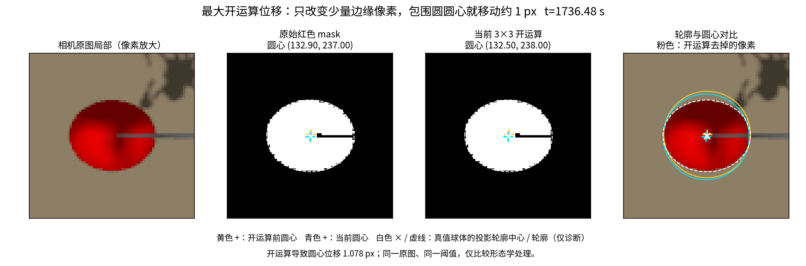

# UAV_slung：PESO 研究问题、技术路线与论文差异定位

> **研究定位：**在已有多速率 PESO 的输出预测与观测器耦合思想基础上，研究**面向非线性无人机吊挂系统的视觉预测补全与异常感知校正 PESO**。

## 一、我们遇到的核心问题

### 1. 视觉摆角与加速度输入存在速率失配、时间错位

- **视觉测量**：相机提供的吊载摆角 $\theta$，更新频率较低，并存在采集、计算、传输延迟。
- **动力学输入**：PX4 提供的加速度信息 $a$，更新频率较高、延迟低。

单平面吊挂动力学为：

$$
\boxed{\ddot\theta=-\frac{g}{l}\sin\theta-\frac{a}{l}\cos\theta+f}
$$

其中 $f$ 为等效角加速度扰动，加速度作用项 $-\frac{a}{l}\cos\theta$ **同时依赖高频加速度 $a$ 与低频视觉摆角 $\theta$**。
- **速率失配：** 若简单地使用零阶保持器（ZOH）令**上一帧摆角**与**当前实时更新的加速度**进行计算，可能引入模型计算偏差，并传递到观测器的角速度与扰动估计中。
- **时间错位：** 由于**视觉采集、处理及传输存在延迟**，视觉摆角为**晚到的历史测量数据**，因此不能直接将**历史视觉摆角**与**当前时刻的高频加速度**融合计算。


### 2. 视觉测量存在像素跳变与局部异常

视觉摆角并非始终平滑可靠，尤其需要关注两类问题：

1. **整数像素引起的摆角阶梯：** 受相机有限分辨率影响，即使载荷连续摆动，检测圆心也可能在用**整数像素圆心坐标**间跳变，进而使解算摆角出现台阶或往返波动，从而影响视觉摆角测量的真实性。
2. **轮廓识别引起的局部尖峰：** 局部遮挡、分割轮廓、形态学处理、以及圆心提取方式，会使同一目标的检测圆心发生短时偏移。


3. **其他可能存在的问题：** 相机内参、外参和标定误差可能造成测量偏差，当前已修正球体透视与悬挂点几何；更换相机或模型后仍需重新标定、验证。

**核心需求：把低频、可能延迟且包含量化台阶或局部异常的视觉摆角，可靠地预测补全为与高频加速度时间对齐的 ESO 输入，并抑制错误视觉信息对扰动估计的影响**

---

## 二、我要做什么：预测补全 + 可靠校正 + ESO 耦合

**首要目标不是简单提高 ESO 的输出频率，而是在 ESO 输入端生成与加速度 $a$ 同频、同时间轴的预测摆角 $\hat\theta_P$，并利用真实视觉持续纠偏。**

```text
低频视觉 θv(tk) → [采样时刻对齐 + 异常判断/校正] → [预测器 P] → 高频 θ̂P(t) ──┐
                                                           ↑                      │
高频加速度 a(t) → [时间戳与输入历史] ───────────────→ P 动力学传播               ├→ [同步输入 ESO] → (θ̂, ω̂, f̂) → ADRC
                         └──────────────────────────────→ 同时刻加速度 a(t) ───────┘            │
                                                           ↑                                   │
                                                           └──────── ESO 反馈 ω̂（必要时含 f̂）←┘
```


### 核心能力 A｜预测补全（P）

在两帧视觉之间，利用 ESO 的角速度估计 $\hat\omega$ 进行积分，并结合高频加速度 $a$ 与非线性动力学传播状态，按 ESO 的工作频率生成摆角预测：

$$
\hat\theta_P(t)=\hat\theta_P(t_0)+\int_{t_0}^{t}\hat\omega_P(\tau)\,\mathrm d\tau
$$

其中 $\hat\omega_P$ 的来源及其与 ESO 估计 $\hat\omega$ 的耦合方式**待具体设计**。这一步是**基于动力学的预测补全**，不是增加相机真实采样率，也不是把插值数据当作独立的新观测。

### 核心能力 B｜异常感知的可靠视觉校正

新视觉到来时，先根据其**原始采样时刻**构造预测残差：

$$
\boxed{r_v(t_k)=\theta_v(t_k)-\hat\theta_P^-(t_k)}
$$

根据残差及测量质量判断可信程度：正常测量用于修正预测状态；对于**整数像素阶梯、异常圆心突变**等疑似异常，可考虑降权、限幅或暂缓融合，避免把突变直接注入预测器及 ESO。若视觉存在传输延迟，应先在**原始采样时刻**校正，再利用历史加速度和模型推进到当前时刻。

> 这里的“可靠校正”是**拟研究的设计目标**；残差判别规则、校正增益和异常检测误判影响尚未确定。大残差也可能来自真实快速运动，不能一律视为坏数据。

### 核心能力 C｜预测器与 ESO 的双向耦合

- **P → ESO**：将高频 $\hat\theta_P$ 与同时间戳的 $a$ 共同送入 ESO。
- **ESO → P**：使用 ESO 的 $\hat\omega$，必要时结合 $\hat f$，帮助预测器在无新视觉时持续传播。
- **关键待解问题**：规定预测、视觉校正、ESO 更新的时序，避免代数环、重复使用同一视觉信息，以及预测误差和扰动估计误差相互放大。

这三个能力构成一个整体：**预测补全解决输入频率失配，异常感知校正限制视觉跳变传播，P–ESO 耦合维持高频状态与扰动估计。**

---

## 三、论文定位与待验证贡献

### 一句话研究定位

**面向非线性无人机吊挂系统的双源异频与视觉异常问题，研究基于 P–ESO 耦合的高频视觉摆角预测补全与鲁棒校正方法。**

### 候选论文题目

**面向无人机吊挂系统的多速率视觉预测补全与异常感知校正 PESO**

### 拟形成的三个研究贡献

1. **双源异频非线性预测结构**：利用高频加速度与 ESO 状态反馈，将低频视觉摆角预测补全至观测器输入频率，重点处理 $a\cos\theta$ 耦合项。
2. **基于预测残差的鲁棒视觉校正**：在视觉实际采样时刻辨别整数像素阶梯与局部圆心异常，设计可信度相关的校正方式，并与延迟补偿衔接。
3. **P–ESO 耦合误差分析与验证**：分析预测误差、视觉异常和 ESO 扰动估计之间的相互作用，给出稳定性/误差有界性论证或明确的适用条件，并通过对照实验评估。


